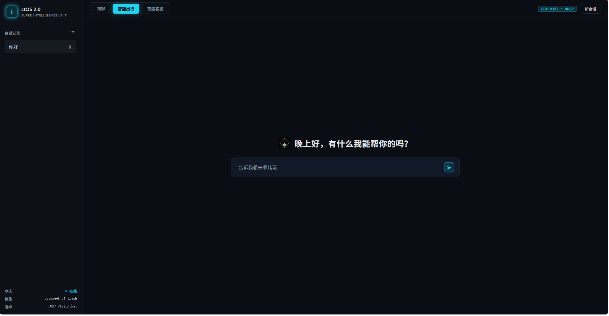
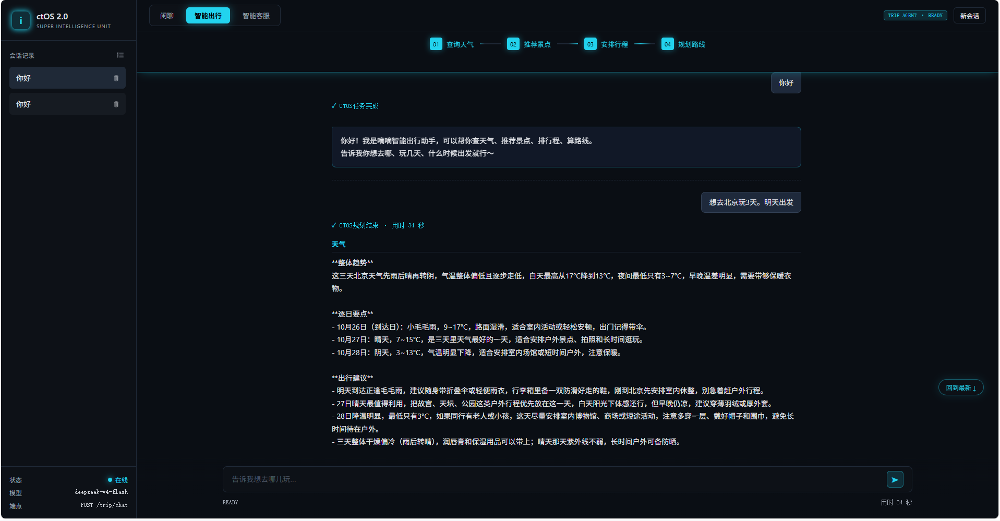
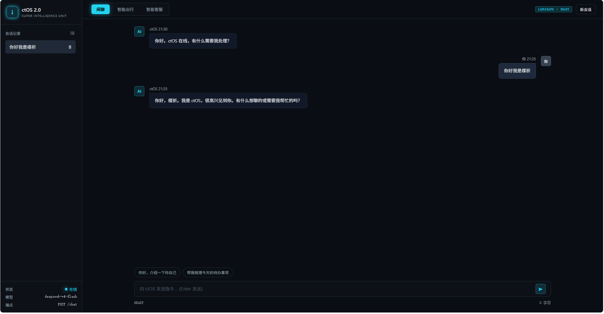
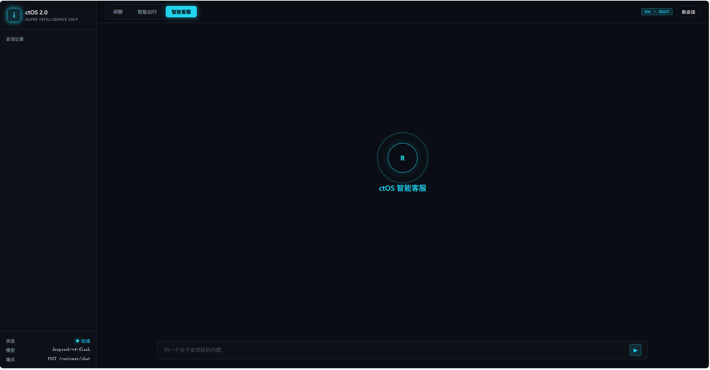
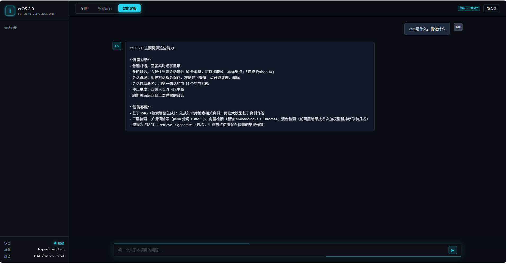

# ctOS 2.0

一个 FastAPI + LangGraph 的多模块 AI 应用：**闲聊对话**、**智能出行规划**、**RAG 智能客服**，三种能力跑在同一个服务、同一个端口、同一个前端页面里，数据存 PostgreSQL。

支持 Docker 一键部署，也可以在本地直接运行。

---

## 界面

**智能出行** — 开场页居中输入，规划过程有分步进度，输出是连贯的行程文档：

<p>
  
  
</p>

**闲聊** — 多轮记忆、会话切换：



**智能客服** — 基于本地文档的 RAG 问答：

<p>
  
  
</p>

---

## 三个模块

| 模块 | 路由 | 能做什么 |
| --- | --- | --- |
| **闲聊** | `POST /chat` | 多轮对话，有会话记忆，能翻历史 |
| **智能出行** | `POST /trip/chat` | 查天气、搜景点、排行程、算路线，四段连续产出 |
| **智能客服** | `POST /customer/chat` | 基于本地文档的 RAG 问答，支持上下文追问 |

三个模块共用一个 FastAPI 应用、一套数据库、一套前端。各模块只负责自己的图和提示词。

---

## 快速开始

### 方式一：Docker（推荐）

> **配置只有一份**：`config/.env`。代码和 Docker 都读它，根目录不放副本。
> 所以所有 `docker compose` 命令都要带 `--env-file config/.env`
> （忘了带会直接报错，并在报错里告诉你正确命令）。

```bash
# 1. 配置密钥
cp config/YOUR_config.env config/.env
# 编辑 config/.env，填入 API 密钥

# 2. 启动
docker compose --env-file config/.env up -d
docker exec ctos2-app python -m core.db    # 首次要建表

# 3. 打开浏览器
# http://127.0.0.1:8080/
```

详细说明见 [docs/deployment.md](docs/deployment.md)。

### 方式二：本地运行

**前提**：Python 3.14、PostgreSQL 17

```bash
# 1. 启动 PostgreSQL
D:\PostgreSQL\pgsql\bin\pg_ctl.exe -D D:\PostgreSQL\data start

# 2. 装依赖
python -m venv venv
venv\Scripts\activate
pip install -r config/requirements.txt

# 3. 配置密钥
cp config/YOUR_config.env config/.env
# 编辑 config/.env

# 4. 建表 + 启动
python -X utf8 -m core.db
python -X utf8 -m api.main
```

### 必需的配置

`config/.env` 里至少填这些：

```ini
# AI 服务
DEEPSEEK_API_KEY=你的密钥
DEEPSEEK_BASE_URL=https://api.deepseek.com
DEEPSEEK_MODEL=deepseek-chat
ZHIPU_API_KEY=你的密钥          # 客服需要

# 数据库
PG_HOST=127.0.0.1
PG_PORT=5432
PG_DBNAME=ctos2
PG_USER=ctos_app
PG_PASSWORD=你的密码

# 认证
JWT_SECRET_KEY=你的密钥
```

**生成 JWT 密钥：**

```bash
python -c "import secrets; print(secrets.token_urlsafe(48))"
```

---

## 项目结构

```
ctOS2.0/
├── api/            接口层（路由）
│   ├── main.py         所有路由
│   └── routes/auth.py  认证路由
├── core/           跨模块公用
│   ├── llm.py          唯一的模型客户端
│   ├── db.py           数据库连接
│   ├── auth.py         密码哈希 + JWT
│   └── sse.py          SSE 打包
├── databases/      表定义和读写
│   ├── db_auth.py      users 表
│   ├── db_chat.py      闲聊的表
│   ├── db_trip.py      出行的表
│   └── db_view.py      命令行查看工具
├── modules/        三个业务模块
│   ├── chat/           闲聊
│   ├── trip/           智能出行
│   └── customer/       RAG 客服（含 data/docs 知识库）
├── static/         前端
│   ├── js/common/      公用 JS
│   ├── js/app.js       闲聊 + 视图切换
│   ├── js/trip.js      出行
│   └── js/customer.js  客服
├── docs/           文档
│   ├── architecture.md 请求地图（代码怎么流转）
│   ├── files.md        每个文件做什么
│   └── deployment.md   部署说明
└── config/         配置
```

**不知道某个文件是做什么的？看 [docs/files.md](docs/files.md)。**

---

## 数据库

**PostgreSQL 17**，8 张表，多租户。

| 表 | 存什么 |
| --- | --- |
| `tenants` | 租户（一个用户对应一个租户） |
| `users` | 账号（密码存 bcrypt 哈希） |
| `sessions` / `messages` | 闲聊的会话和消息 |
| `trip_chats` | 出行会话 |
| `trip_sessions` | 出行的每一轮 |
| `trip_user_inputs` / `trip_ai_outputs` | 每一轮的用户原话 / AI 四段产出 |

**所有业务表都有 `tenant_id`**，查询时带上它做数据隔离。

### 查看数据

```bash
# 命令行
python -X utf8 -m databases.db_view            # 用户 + 会话列表
python -X utf8 -m databases.db_view stats      # 统计
python -X utf8 -m databases.db_view trips      # 出行列表
python -X utf8 -m databases.db_view show 5     # 某个会话的对话

# 或者用 psql / VS Code 插件连
# host=127.0.0.1  port=5432  db=ctos2  user=ctos_app
```

---

## 智能客服：更新知识库

知识库文档在 `modules/customer/data/docs/*.md`。

**改了文档后必须重新入库**，否则客服用的还是旧内容：

```bash
python -X utf8 -m modules.customer.rag_ingest
```

然后重启服务。

**检测检索质量：**

```bash
python -X utf8 -m modules.customer.rag_eval            # 跑 40 题题库
python -X utf8 -m modules.customer.rag_eval --fails    # 只看未命中
```

题库在 `modules/customer/eval/golden.json`，分四类：原词 / 同义改写 / 跨章节 / 库外。

---

## 单独调试模块

```bash
# 出行（终端里对话）
python -X utf8 -m modules.trip.cli
```

> Windows 控制台默认 GBK，不加 `-X utf8` 中文会乱码。

---

## 技术栈

| 层 | 用什么 |
| --- | --- |
| Web 框架 | FastAPI + Uvicorn |
| Agent 编排 | LangGraph |
| 模型 | DeepSeek（对话与推理）+ 智谱（向量化） |
| 数据库 | PostgreSQL 17 |
| 向量库 | Chroma |
| 检索 | jieba + BM25 + 向量混合 |
| 认证 | JWT + bcrypt |
| 部署 | Docker + Docker Compose |
| 前端 | 原生 JS，无构建步骤 |

---

## 已知限制

**数据与存储**

- 多租户目前只有表结构，**还没有团队协作**（一人一户）
- 智能客服不写数据库，刷新页面上下文就没了

**外部依赖**

- 三个模块都依赖外部 API，密钥缺失时对应功能不可用
- 出行一次规划会调用十几次模型，注意额度
- 客服的向量检索依赖智谱接口，余额不足时不可用

**功能边界**

- 闲聊没有检索能力，问项目相关问题可能编造
- 客服查不到资料时只会说"没找到"，不会自己找
- 出行只支持驾车/步行，没有公交地铁

**工程质量**

- **没有自动化测试**。`rag_eval.py` 是手工跑的检索测评，不属于测试套件
- 没有登录限流，可以被暴力试密码
- 前端 `trip.js`（645 行）和 `modules.css`（619 行）偏大，以后可拆

---

## 更多文档

| 想看什么 | 去哪 |
| --- | --- |
| 代码怎么流转（请求地图） | [docs/architecture.md](docs/architecture.md) |
| 每个文件做什么 | [docs/files.md](docs/files.md) |
| 怎么部署（Docker / 本地） | [docs/deployment.md](docs/deployment.md) |
| 前端怎么组织 | [static/README.md](static/README.md) |

---

## License

MIT
