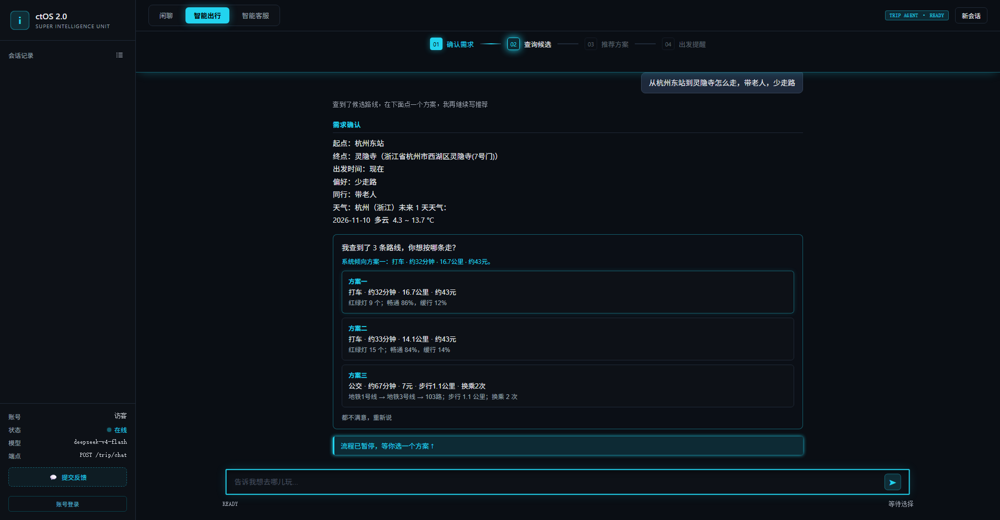
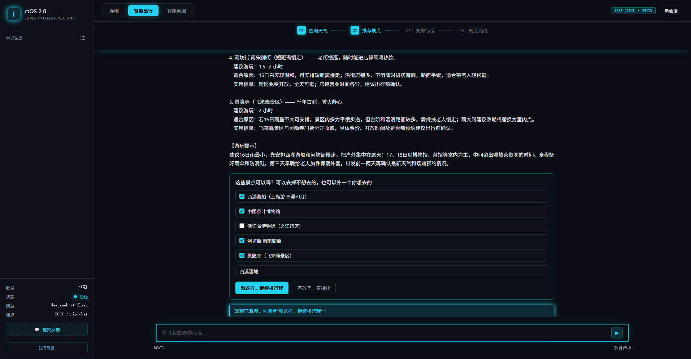
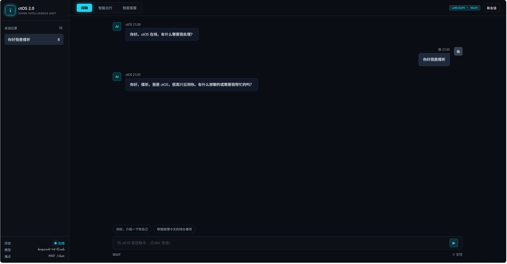
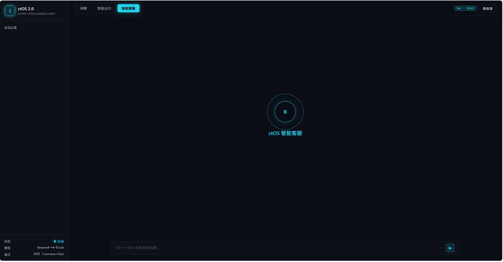
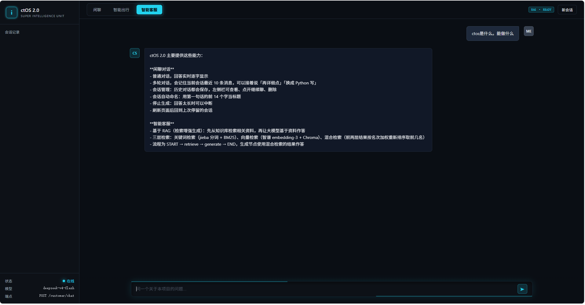

# ctOS 2.0

一个 FastAPI + LangGraph 的多模块 AI 应用：**闲聊对话**、**角色扮演**、**智能出行规划**、**RAG 智能客服**，四种能力跑在同一个服务、同一个端口、同一个前端页面里，数据存 PostgreSQL。

**线上地址：<https://ctos2.cn>**（也可用 `www.ctos2.cn`）——打开页面会自动进入访客空间，注册账号后可跨设备保留记录。

支持 Docker 一键部署，也可以在本地直接运行。

---

## 界面

**智能出行** — 两种模式，都会在中途停下来让你确认：

- 问“从 A 到 B 怎么走”：查真实的多条方案，**你选一条**，再写对比和推荐
- 问“去某地玩几天”：出完景点清单**让你勾选**，确认后再排行程、算路线

<p>
  
  
</p>

**闲聊 + 角色扮演** — 多轮记忆、会话切换、会话自动命名：



**智能客服** — 基于本地文档的 RAG 问答：

<p>
  
  
</p>

---

## 功能模块

### 三个页面标签（顶栏切换）

| 模块 | 路由 | 能做什么 |
| --- | --- | --- |
| **闲聊** | `POST /chat` | 多轮对话，有会话记忆，能翻历史 |
| **智能出行** | `POST /trip/chat` | 路线决策（多方案对比、人工选方案）+ 旅游攻略（天气、景点、行程、路线） |
| **智能客服** | `POST /customer/chat` | 基于本地文档的 RAG 问答，支持上下文追问 |

### 角色扮演（挂在闲聊里，侧栏独立菜单）

传 `role_id` 走 `POST /chat`，会话和消息复用闲聊的表，只在 `role_play_sessions` 里记「这个会话是哪个角色」。

- **预设角色**（写在 `modules/roleplay/presets.py`，改完重启生效）+ **自己写角色**（存 `role_play_roles` 表）
- **AI 帮我查**：联网搜资料生成角色草稿，确认后再保存
- **角色记忆**：每聊 6 轮把对话压缩成 200 字以内的摘要，可查看、可清空
- **角色档案**：聊天顶部查看完整设定

### 反馈与公告

- `POST /feedback`：评价 + 文字反馈，同一 IP 每分钟限 3 条；不强制登录
- `GET /notice`：更新公告，内容来自 `config/notice.json`，改完刷新页面生效

三个页面模块共用一个 FastAPI 应用、一套数据库、一套前端。各模块只负责自己的图和提示词。

---

## 主题

右上角「主题」按钮可以切三套：**简洁现代**（默认）、**街头黑客**、**赛博暗色**。
选择记在浏览器 `localStorage` 里，刷新后保留。主题只改样式，不影响 SSE、人工确认和计时。

改版式/加组件时不用三套各写一遍：布局只有一份，颜色和边框在主题层补。
具体见 [docs/themes.md](docs/themes.md)。

---

## 快速开始

### 方式零：直接用线上版（什么都不用装）

打开 <https://ctos2.cn> 直接就能用，不用注册、也不用点登录：首次进入会自动创建一个
**访客空间**（独立租户，聊天和出行记录只存在当前浏览器，换设备不同步）。
想跨设备保留记录，再点侧栏底部的「账号登录」注册或登录真实账号即可。

自动建访客账号的实现见 `api/routes/trial.py`（独立文件，不要了可以整块删掉）。

### 方式一：Docker（推荐）

> **配置只有一份**：`config/.env`。代码和 Docker 都读它，根目录不放副本。
> 所以所有 `docker compose` 命令都要带 `--env-file config/.env`
> （忘了带会直接报错，并在报错里告诉你正确命令）。

```bash
# 1. 配置密钥
cp config/YOUR_config.env config/.env
# 编辑 config/.env，填入 API 密钥

# 2. 启动
docker compose --env-file config/.env up -d
docker exec ctos2-app python -m core.db    # 首次要建表

# 3. 打开浏览器
# http://127.0.0.1:8080/
```

> `static/` 已挂载进容器：改前端文件后刷新页面即可生效；
> 改 Python 代码（`core/`、`api/`、`modules/`）才需要重新构建：
> `docker compose --env-file config/.env up -d --build app`。

详细说明见 [docs/deployment.md](docs/deployment.md)。

### 方式二：本地运行

**前提**：Python 3.14、PostgreSQL 17

```bash
# 1. 启动 PostgreSQL
D:\PostgreSQL\pgsql\bin\pg_ctl.exe -D D:\PostgreSQL\data start

# 2. 装依赖
python -m venv venv
venv\Scripts\activate
pip install -r config/requirements.txt

# 3. 配置密钥
cp config/YOUR_config.env config/.env
# 编辑 config/.env

# 4. 建表 + 启动
python -X utf8 -m core.db
python -X utf8 -m api.main
```

### 必需的配置

`config/.env` 里至少填这些：

```ini
# AI 服务
DEEPSEEK_API_KEY=你的密钥
DEEPSEEK_BASE_URL=https://api.deepseek.com
DEEPSEEK_MODEL=deepseek-chat
ZHIPU_API_KEY=你的密钥          # 客服需要
AMAP_KEY=你的密钥               # 出行的路线查询需要

# 数据库
PG_HOST=127.0.0.1
PG_PORT=5432
PG_DBNAME=ctos2
PG_USER=ctos_app
PG_PASSWORD=你的密码

# 认证
JWT_SECRET_KEY=你的密钥
```

**生成 JWT 密钥：**

```bash
python -c "import secrets; print(secrets.token_urlsafe(48))"
```

---

## 项目结构

```
ctOS2.0/
├── api/            接口层（路由）
│   ├── main.py         所有路由（含反馈、公告、角色扮演）
│   └── routes/
│       ├── auth.py     注册 / 登录 / 当前用户
│       └── trial.py    访客账号（可整块删）
├── core/           跨模块公用
│   ├── llm.py          唯一的模型客户端
│   ├── db.py           数据库连接 + 建表总入口
│   ├── auth.py         密码哈希 + JWT
│   └── sse.py          SSE 打包 + 同步生成器转线程
├── databases/      表定义和读写
│   ├── db_tenant.py    tenants
│   ├── db_auth.py      users
│   ├── db_chat.py      sessions / messages
│   ├── db_trip.py      出行的 4 张表
│   ├── db_roleplay.py  角色扮演的 3 张表
│   ├── db_feedback.py  feedback
│   ├── db_view.py      命令行查看工具
│   ├── clean_db.py     命令行清理工具
│   └── feedback_view.py 命令行查看反馈
├── modules/        四个业务模块
│   ├── chat/           闲聊
│   ├── roleplay/       角色扮演
│   ├── trip/           智能出行
│   └── customer/       RAG 客服（含 data/docs 知识库）
├── static/         前端
│   ├── js/common/      公用 JS
│   ├── js/app.js       闲聊 + 角色扮演 + 视图切换
│   ├── js/trip.js      出行
│   └── js/customer.js  客服
├── docs/           文档
├── eval/           端到端测评
├── scripts/        线上检查脚本
└── config/         配置
```

**不知道某个文件是做什么的？看 [docs/files.md](docs/files.md)。**

---

## 数据库

**PostgreSQL 17**，12 张表，多租户（一人一户）。

| 表 | 存什么 |
| --- | --- |
| `tenants` | 租户（一个用户对应一个租户） |
| `users` | 账号（密码存 bcrypt 哈希） |
| `sessions` / `messages` | 闲聊和角色扮演的会话和消息 |
| `trip_chats` | 出行会话 |
| `trip_sessions` | 出行的每一轮 |
| `trip_user_inputs` / `trip_ai_outputs` | 每一轮的用户原话 / AI 产出 |
| `role_play_sessions` | 哪个会话用的是哪个角色 |
| `role_play_memories` | 每个角色记住的事（按租户 + 角色存一篇摘要） |
| `role_play_roles` | 用户自己写的角色 |
| `feedback` | 用户反馈 |

**所有业务表都有 `tenant_id`**，查询时带上它做数据隔离。
除此之外还有两处**不入 git 的运行产物**：`databases/checkpoints/`（LangGraph 暂停现场，SQLite）和
`modules/customer/data/chroma/`（客服向量库）。

**改了 Python 代码后**，跑一次建表命令可以补上新增的表和字段（`CREATE ... IF NOT EXISTS` / `ALTER ... IF NOT EXISTS`，不动已有数据）：

```bash
python -X utf8 -m core.db
```

### 查看数据

```bash
# 命令行
python -X utf8 -m databases.db_view            # 用户 + 会话列表
python -X utf8 -m databases.db_view stats      # 统计
python -X utf8 -m databases.db_view trips      # 出行列表
python -X utf8 -m databases.db_view show 5     # 某个会话的对话
python -X utf8 -m databases.db_view search 端口 # 在所有消息里搜关键词

# 用户的反馈（不对外开接口，只走命令行）
python -X utf8 -m databases.feedback_view        # 最近 20 条
python -X utf8 -m databases.feedback_view stats  # 统计

# 或者用 psql / VS Code 插件连
# host=127.0.0.1  port=5432  db=ctos2  user=ctos_app
# Docker 的话端口是 5433
```

### 清理数据

```bash
python -X utf8 -m databases.clean_db            # 本机 5432
python -X utf8 -m databases.clean_db --docker   # Docker 5433（8080 页面用的库）
docker exec -it ctos2-app python -m databases.clean_db   # 在容器里清理
```

菜单里可以选：查看现状、清理访客账号、清理某个账号的聊天/出行、删除某个账号、
清理全部闲聊/出行/反馈。删除前会显示条数，并要求输入确认词。

**不想敲命令，直接双击根目录的两个文件：**

- `清理数据库-Docker.bat`：清 8080 页面用的 Docker 库（5433）
- `清理数据库-本机.bat`：清本机 5432 的库

双击后先选「查看数据库现状」确认连对了库，再选清理项。

---

## 智能客服：更新知识库

知识库文档在 `modules/customer/data/docs/*.md`（3 个文件：系统手册、功能清单、详细说明）。

**改了文档后必须重新入库**，否则客服用的还是旧内容：

```bash
python -X utf8 -m modules.customer.rag_ingest
```

然后重启服务。

**检测检索质量：**

```bash
python -X utf8 -m modules.customer.rag_eval            # 跑 40 题题库
python -X utf8 -m modules.customer.rag_eval --fails    # 只看未命中
```

题库在 `modules/customer/eval/golden.json`，分四类：原词 / 同义改写 / 跨章节 / 库外。

---

## 测评与调试

```bash
# 端到端测评：跑真实接口 + 自动检查 + 出报告（题库 34 条）
python -X utf8 eval/run_eval.py

# 出行模块，终端里对话
python -X utf8 -m modules.trip.cli

# 检查线上是否可访问
powershell -ExecutionPolicy Bypass -File scripts\check_online.ps1
```

> Windows 控制台默认 GBK，不加 `-X utf8` 中文会乱码。

`eval/` 是**能重复跑的验收工具**，不是单元测试套件；怎么加题、怎么读结果见 [eval/README.md](eval/README.md)。

---

## 技术栈

| 层 | 用什么 |
| --- | --- |
| Web 框架 | FastAPI + Uvicorn |
| Agent 编排 | LangGraph |
| 模型 | DeepSeek（对话与推理）+ 智谱（向量化） |
| 数据库 | PostgreSQL 17 |
| 向量库 | Chroma |
| 检索 | jieba + BM25 + 向量混合 |
| 地图 | 高德（路线决策） |
| 天气 | Open-Meteo（免密钥） |
| 认证 | JWT + bcrypt |
| 部署 | Docker + Docker Compose，Cloudflare 托管域名与 TLS |
| 前端 | 原生 JS，无构建步骤；手机端做了基础适配（侧栏收成抽屉） |

---

## 已知限制

**数据与存储**

- 多租户目前只有表结构，**还没有团队协作**（一人一户）
- 智能客服不写数据库，刷新页面上下文就没了
- 访客账号不会自动清理，会慢慢堆积（用 `clean_db.py` 或 `DELETE FROM users WHERE email LIKE '%@ctos-trial.local'`）

**外部依赖**

- 四个能力都依赖外部 API，密钥缺失时对应功能不可用
- 出行一次规划会调用十几次模型，注意额度
- 客服的向量检索依赖智谱接口，余额不足时不可用
- 路线决策依赖高德 Key，没有 Key 时只能走攻略流程

**功能边界**

- 闲聊没有检索能力，问项目相关问题可能编造
- 客服查不到资料时只会说"没找到"，不会自己找
- 出行的攻略流程里，真实路线查询只支持同城驾车/步行等有限方式

**工程质量**

- **没有单元测试套件**。`eval/run_eval.py` 是能重复跑的端到端验收工具，`rag_eval.py` 是手工跑的检索测评，
  两者都是"手动跑"的，不会在提交时自动执行
- 没有登录限流，可以被暴力试密码
- 前端 `trip.js`（1489 行）、`modules.css`（2593 行）、`theme.css`（1643 行）偏大，以后可拆

---

## 更多文档

| 想看什么 | 去哪 |
| --- | --- |
| 代码怎么流转（请求地图） | [docs/architecture.md](docs/architecture.md) |
| 每个文件做什么 | [docs/files.md](docs/files.md) |
| 怎么部署（Docker / 本地） | [docs/deployment.md](docs/deployment.md) |
| 前端怎么组织 | [static/README.md](static/README.md) |
| 怎么跑测评 | [eval/README.md](eval/README.md) |
| 主题怎么维护 | [docs/themes.md](docs/themes.md) |
| 线上打不开怎么排查 | [docs/tunnel-check.md](docs/tunnel-check.md) |

---

## License

MIT
