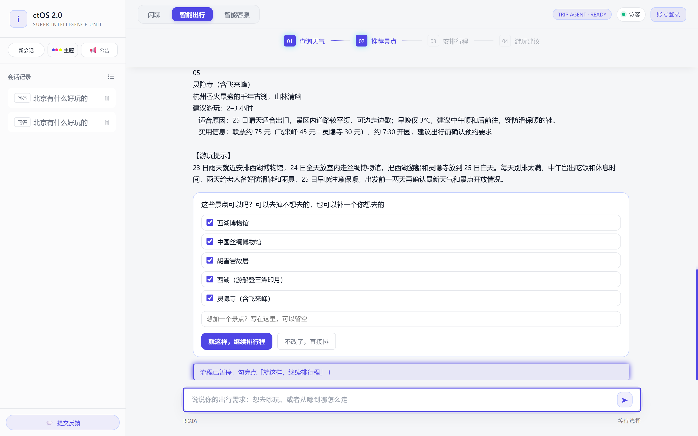
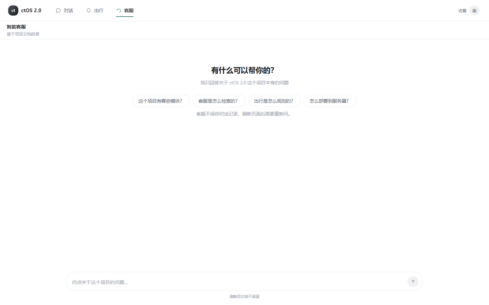

# ctOS 2.0

把四个 AI 能力放在同一个网站里：**对话**、**角色扮演**、**智能出行**、**智能客服**。

后端 FastAPI + LangGraph，前端 Vue 3，数据存 PostgreSQL。

线上地址：<https://ctos2.cn>

---

## 界面

<p>
  
  
</p>

<p>
  
  
</p>

<p>
  
  
</p>

---

## 功能

**对话**

多轮对话，会话存在左侧栏。支持上传图片提问，说「画一只猫」会调生图。

**角色扮演**

挂在对话下面。有预设角色，也能自己写一个（填人设，或者输入名字让 AI 联网查资料生成草稿）。
每聊 6 轮自动压缩成一段摘要作为角色记忆，换个会话和同一个角色聊，它还记着上次说过什么。

**智能出行**

一个输入框，不选模式。说「北京有什么好玩的」它直接答，说「从 A 到 B 怎么走」它查路线，
说「下周去杭州玩 3 天」它排行程。

路线和攻略这两个流程中途会停下来等人操作：

- 路线：查出几条方案，让你选一条，再写对比和推荐
- 攻略：出完景点清单，让你勾掉不想去的，确认后才排行程

不选就卡在那里，不会替人做决定。

**智能客服**

基于本地文档的 RAG 问答，只回答关于这个项目的问题，查不到就说没找到，不编。
支持追问（「那它怎么配」能接上上一句）。

---

## 本地运行

需要 Python 3.14 和 PostgreSQL 17。

```bash
# 1. 装依赖
python -m venv venv
venv\Scripts\activate
pip install -r requirements.txt

# 2. 配置
copy config\.env.example .env
# 编辑 .env，填 API 密钥和数据库连接

# 3. 建表（第一次，或改了表结构后）
python -X utf8 -m databases.schema

# 4. 启动
python -X utf8 -m common.main
```

浏览器打开 <http://127.0.0.1:8080/>。

建表脚本是 `databases/schema.sql`，也可以直接用 psql 跑。全部 `CREATE ... IF NOT EXISTS`，跑在已有数据的库上不会丢数据。

### 必需的配置

`.env` 在项目根目录：

```ini
# AI
DEEPSEEK_API_KEY=
DEEPSEEK_BASE_URL=https://api.deepseek.com
DEEPSEEK_MODEL=deepseek-chat
ZHIPU_API_KEY=          # 客服的向量化
AMAP_KEY=               # 出行的路线查询
SEEDREAM_API_KEY=       # 生图

# 数据库
PG_HOST=127.0.0.1
PG_PORT=5432
PG_DBNAME=ctos2
PG_USER=ctos_app
PG_PASSWORD=

# 登录
JWT_SECRET_KEY=         # python -c "import secrets; print(secrets.token_urlsafe(48))"
```

缺哪个密钥，对应功能就不可用，其他功能不受影响。

---

## 项目结构

```
├── common/         启动入口和模型客户端
│   ├── main.py         python -m common.main
│   └── llm.py          所有模块从这里取模型
├── api/            HTTP 接口
│   ├── main.py         建 app + 挂静态 + 装路由
│   ├── deps.py         租户解析、图片校验
│   ├── security.py     密码哈希 + JWT
│   └── routes/         每个模块一个文件
├── modules/        业务模块
│   ├── chat/           对话（roleplay/ 是角色扮演）
│   ├── trip/           出行（route/ 路线，guide/ 攻略）
│   ├── customer/       客服（rag/ 是检索系统）
│   └── generate_prompts/  提示词生成
├── tools/          两个以上模块在用的工具
│   ├── search.py       联网搜索
│   └── imagesproduct.py 生图
├── databases/      数据层
│   ├── conn.py         连接和通用操作
│   ├── schema.sql      建表语句
│   └── modules/        每个模块一张表的增删改查
├── cli/            终端入口，不用起服务就能跑单个模块
├── web/            前端
│   ├── src/            源码
│   └── dist/           构建产物
└── docs/corpus/    客服知识库源文件
```

每个模块内部按同一套结构组织：`state` / `create_graph` / `node` / `prompts` / `stream`。

---

## 常用命令

```bash
# 改完前端
cd web && npm run build

# 改完 Python 重启服务，改完 .vue 要 build

# 单独跑某个模块（不用起 Web 服务）
python -X utf8 -m cli.chat        # 对话
python -X utf8 -m cli.trip        # 出行
python -X utf8 -m cli.customer    # 客服

# 改了客服知识库后重新入库，然后重启服务
python -X utf8 -m modules.customer.rag.rag_ingest

# 看数据库
python -X utf8 -m databases.tools.view

# 清数据（也支持双击 databases\tools\清理数据库-本机.bat）
python -X utf8 -m databases.tools.clean
```

Windows 控制台默认 GBK，不加 `-X utf8` 中文会乱码。

---

## 技术栈

| | |
| --- | --- |
| 后端 | FastAPI + Uvicorn |
| Agent | LangGraph |
| 模型 | DeepSeek（对话推理）、智谱（向量化）、Seedream（生图） |
| 数据库 | PostgreSQL |
| 检索 | jieba + BM25 + Chroma 向量，混合打分 |
| 外部数据 | 高德地图（路线）、Open-Meteo（天气）、DeepSeek Search（联网） |
| 前端 | Vue 3 + TypeScript + Vite |
| 部署 | uvicorn + Cloudflare Tunnel |

---

## License

MIT
