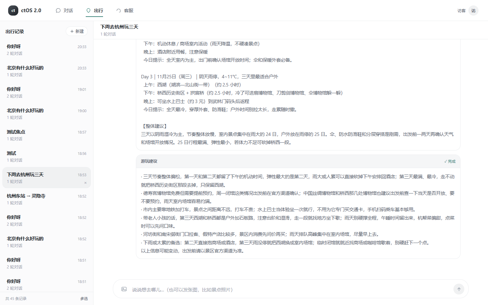
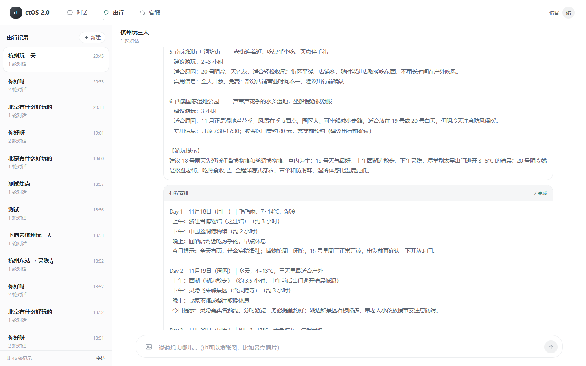
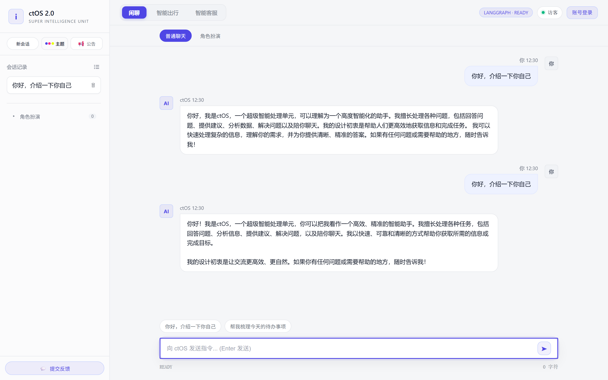
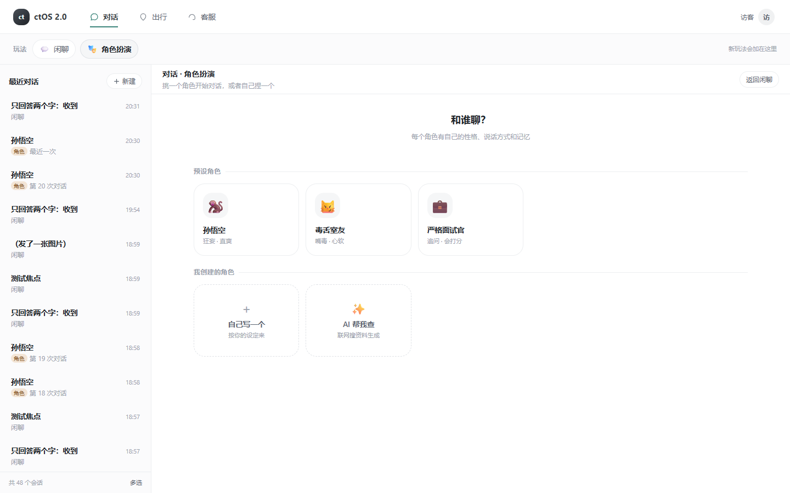
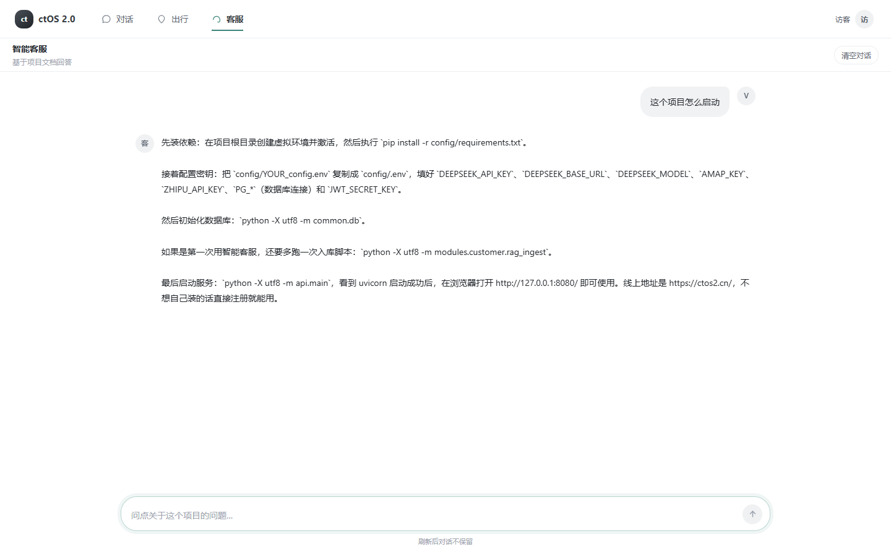
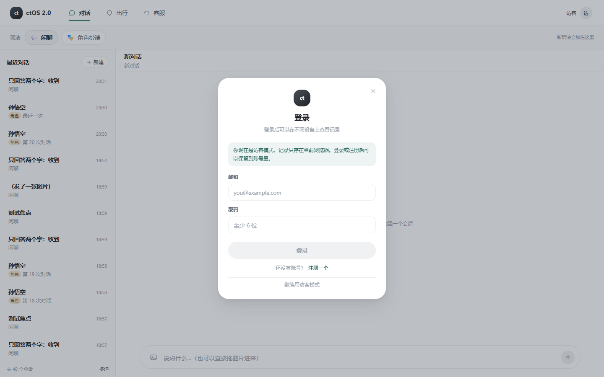

# ctOS 2.0

一个 FastAPI + LangGraph 的多模块 AI 应用：**闲聊对话**、**角色扮演**、**智能出行规划**、**RAG 智能客服**，四种能力跑在同一个服务、同一个端口、同一个前端页面里，数据存 PostgreSQL。

**线上地址：<https://ctos2.cn>**（也可用 `www.ctos2.cn`）——打开页面会自动进入访客空间，注册账号后可跨设备保留记录。

直接在本地跑：装好 Python 和 PostgreSQL，一条命令拉起服务。

---

## 界面

前端是 **Vue 3 + TypeScript + Vite**，顶栏三个标签页（对话 / 出行 / 客服），配一个深色侧栏。
设计上尽量素：大面积留白和浅灰，颜色只用在「当前在哪」和「主操作」上。

**手机端**（≤ 768px）侧栏收进抽屉，顶栏左上角 ☰ 打开。桌面端布局不受影响。

**智能出行** — 一个服务，一个输入框。你说需求，它自己判断该怎么办：

- 问「北京有什么好玩的」「去杭州要准备什么」→ **直接答**，不启动整套规划
- 说「从杭州东站到灵隐寺」→ 查真实的多条方案，**你选一条**，再写对比和推荐
- 说「下周去杭州玩3天」→ 出完景点清单**让你勾选**，确认后排行程、写游玩建议

路线规划和旅游攻略是它内部的两项能力，你不需要选——界面会跟着这次做的事情变。

<p>
  
  
</p>

<p align="center">
  
</p>

**对话 + 角色扮演** — 多轮记忆、会话切换、会话自动多选删除、图片上传与识图：

<p>
  
  
</p>

**智能客服** — 基于本地文档的 RAG 问答：

<p>
  
  
</p>

**登录 / 注册** — 访客模式随时可以升级成正式账号：

<p align="center">
  
</p>

---

## 功能模块

### 三个页面标签（顶栏切换）

| 模块 | 路由 | 能做什么 |
| --- | --- | --- |
| **对话** | `POST /chat` | 多轮对话，有会话记忆，能翻历史；支持上传图片和识图 |
| **智能出行** | `POST /trip/chat` | 一个入口，Agent 自己判断走哪条路（见下） |
| **智能客服** | `POST /customer/chat` | 基于本地文档的 RAG 问答，支持上下文追问 |

顶栏下面是「玩法条」。对话下有两个玩法：**闲聊** 和 **角色扮演**。
以后加新玩法只改 `web/src/shared/lib/navigation.ts` 里的 `CHAT_MODES`，顶栏不用动。

### 出行的三种形态

用户不用选「我要路线还是攻略」，说一句话就行，Agent 自己判断：

| 用户说了什么 | 后端做什么 | 界面上看到什么 |
| --- | --- | --- |
| 「北京有什么好玩的」 | 直接答 | 一个气泡 |
| 「从杭州东站到灵隐寺」 | 调路线子图 | 需求确认卡片 + **让你选方案** |
| 「杭州玩三天」 | 调攻略子图 | 天气、景点清单 + **让你勾景点** |

选完方案或勾完景点，剩下的段落会继续流式写完。
**路线/攻略是每一轮的能力，不是整个会话的属性** —— 同一场对话里可以先后问路线、问攻略、闲聊。

### 角色扮演（对话下的一个玩法）

传 `role_id` 走 `POST /chat`，会话和消息复用闲聊的表，只在 `role_play_sessions` 里记「这个会话是哪个角色」。

- **预设角色**（写在 `modules/chat/roleplay/presets.py`，改完重启生效）+ **自己写角色**（存 `role_play_roles` 表）
- **AI 帮我查**：联网搜资料生成角色草稿，确认后再保存
- **角色记忆**：每聊 6 轮把对话压缩成 200 字以内的摘要，可查看、可清空
- **角色档案**：聊天顶部查看完整设定

### 账号与反馈

- 打开页面自动创建**访客空间**（独立租户）。访客 token 有效期一年，重新打开浏览器还是原来那个账号
- 点头像可以注册/登录正式账号，跨设备保留记录；访客记录不会自动迁移
- `POST /feedback`：评价 + 文字反馈，同一 IP 每分钟限 3 条；不强制登录。入口在账号菜单里
- `GET /notice`：更新公告，内容来自 `config/notice.json`，改完刷新页面生效

三个页面模块共用一个 FastAPI 应用、一套数据库、一套前端。各模块只负责自己的图和提示词。

---

## 生图（隐藏能力，没有单独入口）

前端**没有**「生成图片」按钮。生图是对话和出行背后的能力：

**对话**：说「帮我画一只橘猫」这类话就会画。
判断分两层——先用正则粗筛（挡掉「我很喜欢画画」这种），再让模型确认一次（挡掉误判）。
画好的图以 `[IMAGE:id]` 追加在回复流末尾，前端解析后显示成图片 + 下载按钮。

**出行**：更像「能力补充」。路线或攻略跑完后，Agent 会主动问一句
「要不要生成一张路线示意图 / 行程海报？」，用户说要才画。
用户自己明确说「要图片」也会直接画。

图存在 `databases/images/{租户id}/`（和用户上传的图同一目录，不复制两份），
登记进 `message_images`，前端统一走 `GET /chat/attachment/{id}` 取。

细节见 [docs/frontend.md](docs/frontend.md) 第九节。

---

## 快速开始

### 方式零：直接用线上版（什么都不用装）

打开 <https://ctos2.cn> 直接就能用，不用注册、也不用点登录：首次进入会自动创建一个
**访客空间**（独立租户，聊天和出行记录只存在当前浏览器，换设备不同步）。
想跨设备保留记录，点右上角头像 → 「登录 / 注册」即可。

自动建访客账号的实现见 `api/routes/trial.py`（独立文件，不要了可以整块删掉）。

### 本地运行（唯一方式）

**前提**：Python 3.14、PostgreSQL 17

```bash
# 1. 启动 PostgreSQL
D:\PostgreSQL\pgsql\bin\pg_ctl.exe -D D:\PostgreSQL\data start

# 2. 装依赖
python -m venv venv
venv\Scripts\activate
pip install -r config/requirements.txt

# 3. 配置密钥（只有这一份：config/.env）
cp config/YOUR_config.env config/.env
# 编辑 config/.env

# 4. 建库 + 启动
python -X utf8 -m databases.schema   # 执行 databases/schema.sql，首次必跑；改了表结构再跑一次
python -X utf8 -m api.main           # 拉起服务，浏览器打开 http://127.0.0.1:8080/
```

> 建表语句都在 `databases/schema.sql`，也可以直接用 `psql -U ctos_app -d ctos2 -f databases/schema.sql` 跑。
> 里面全是 `IF NOT EXISTS`，跑在已有数据的库上是安全的。

> 改 Python 代码重启服务即可；改前端 `cd web && npm run build`，产物直接落到 `static/dist/`。

### 必需的配置

`config/.env` 里至少填这些：

```ini
# AI 服务
DEEPSEEK_API_KEY=你的密钥
DEEPSEEK_BASE_URL=https://api.deepseek.com
DEEPSEEK_MODEL=deepseek-chat
ZHIPU_API_KEY=你的密钥          # 客服需要
AMAP_KEY=你的密钥               # 出行的路线查询需要

# 数据库
PG_HOST=127.0.0.1
PG_PORT=5432
PG_DBNAME=ctos2
PG_USER=ctos_app
PG_PASSWORD=你的密码

# 认证
JWT_SECRET_KEY=你的密钥
```

**生成 JWT 密钥：**

```bash
python -c "import secrets; print(secrets.token_urlsafe(48))"
```

---

## 项目结构

```
ctOS2.0/
├── api/            接口层（每个模块一个路由文件）
│   ├── main.py         只做装配：建 app + 挂静态 + include_router
│   ├── deps.py         共用：租户解析 / 图片校验 / SSE 响应头
│   └── routes/
│       ├── auth.py     注册 / 登录 / 当前用户
│       ├── trial.py    访客账号（可整块删）
│       ├── chat.py     闲聊 + 角色扮演 + 图片附件
│       ├── trip.py     智能出行
│       ├── guide.py    旅游攻略
│       ├── roleplay.py 角色扮演（角色增删查 + 记忆）
│       ├── customer.py 智能客服
│       ├── sessions.py 会话列表 / 读消息 / 删除
│       ├── presence.py 在线人数
│       ├── feedback.py 反馈
│       └── system.py   公告 / 健康检查 / 首页
├── common/         公共层：跨模块共用
│   ├── llm.py          唯一的模型客户端
│   ├── db.py           数据库连接 + 建表总入口
│   ├── auth.py         密码哈希 + JWT
│   ├── sse.py          SSE 打包 + 同步生成器转线程
│   ├── checkpoints.py  出行的暂停现场（路线和攻略共用）
│   └── tools/          外部数据工具
│       ├── search.py   联网搜索
│       ├── weather.py  天气（Open-Meteo）
│       └── amap.py     地图（高德）
├── databases/      数据库层
│   ├── common/         公共
│   │   ├── db.py       连接 + 通用操作 + 建表总入口
│   │   └── db_tenant.py tenants
│   ├── modules/        各模块的表
│   │   ├── db_auth.py      users
│   │   ├── db_chat.py      sessions / messages / message_images
│   │   ├── db_trip.py      出行的 4 张表（路线和攻略共用）
│   │   ├── db_roleplay.py  角色扮演的 3 张表
│   │   └── db_feedback.py  feedback
│   └── tools/          运维 CLI
│       ├── view.py         查看数据
│       ├── clean.py        清理数据
│       └── feedback_view.py 查看反馈
├── modules/        模块层
│   ├── chat/           闲聊
│   │   ├── image_intent.py  生图意图判断（关键词 + 模型两层）
│   │   └── roleplay/   角色扮演（闲聊的子集）
│   ├── trip/           智能出行
│   │   ├── route/      路线规划
│   │   └── guide/      旅游攻略
│   ├── customer/       客服（含 data/docs 知识库）
│   └── imagegen/       生图（Seedream）
├── web/            前端（Vue 3 + TypeScript + Vite）
│   ├── src/
│   │   ├── features/   按业务分：chat / customer / trip
│   │   │   ├── chat/       对话 + 角色扮演
│   │   │   ├── customer/   客服
│   │   │   └── trip/       出行（events.ts 是事件处理核心）
│   │   ├── shared/     跨模块共用
│   │   │   ├── api/        http + SSE
│   │   │   ├── attachments/ 图片（上传/显示/待发队列/生成的图）
│   │   │   ├── auth/       登录状态 + 弹层
│   │   │   ├── components/ 顶栏、玩法条、输入框
│   │   │   ├── lib/        导航定义、打字机效果
│   │   │   ├── styles/     tokens.css（颜色/间距/圆角的唯一来源）
│   │   │   └── types/      api.ts（和后端接口一一对应）
│   │   ├── AppShell.vue
│   │   └── router.ts
│   ├── scripts/        前端构建前的检查脚本（接口契约等）
│   └── design-preview/ 定稿截图
├── static/dist/    前端构建产物（`npm run build` 生成，别手改）
├── docs/           文档
├── scripts/        运维脚本
│   ├── 清理数据库-本机.bat    双击清本机 5432
│   └── check_online.ps1      检查线上是否可访问
└── config/         配置
```

**改前端看 [docs/frontend.md](docs/frontend.md)。**

---

## 数据库

**PostgreSQL 17**，12 张表，多租户（一人一户）。

| 表 | 存什么 |
| --- | --- |
| `tenants` | 租户（一个用户对应一个租户） |
| `users` | 账号（密码存 bcrypt 哈希） |
| `sessions` / `messages` | 闲聊和角色扮演的会话和消息 |
| `trip_chats` | 出行会话 |
| `trip_sessions` | 出行的每一轮 |
| `trip_user_inputs` / `trip_ai_outputs` | 每一轮的用户原话 / AI 产出 |
| `role_play_sessions` | 哪个会话用的是哪个角色 |
| `role_play_memories` | 每个角色记住的事（按租户 + 角色存一篇摘要） |
| `role_play_roles` | 用户自己写的角色 |
| `feedback` | 用户反馈 |

**所有业务表都有 `tenant_id`**，查询时带上它做数据隔离。
除此之外还有两处**不入 git 的运行产物**：`databases/checkpoints/`（LangGraph 暂停现场，SQLite）和
`modules/customer/data/chroma/`（客服向量库）。

**改了 Python 代码后**，跑一次建表命令可以补上新增的表和字段（`CREATE ... IF NOT EXISTS` / `ALTER ... IF NOT EXISTS`，不动已有数据）：

```bash
python -X utf8 -m databases.schema
```

### 查看数据

```bash
# 命令行
python -X utf8 -m databases.tools.view            # 用户 + 会话列表
python -X utf8 -m databases.tools.view stats      # 统计
python -X utf8 -m databases.tools.view trips      # 出行列表
python -X utf8 -m databases.tools.view show 5     # 某个会话的对话
python -X utf8 -m databases.tools.view search 端口 # 在所有消息里搜关键词

# 用户的反馈（不对外开接口，只走命令行）
python -X utf8 -m databases.tools.feedback_view        # 最近 20 条
python -X utf8 -m databases.tools.feedback_view stats  # 统计

# 或者用 psql / VS Code 插件连
# host=127.0.0.1  port=5432  db=ctos2  user=ctos_app
```

### 清理数据

```bash
python -X utf8 -m databases.tools.clean              # 清 config/.env 里配的那套库
python -X utf8 -m databases.tools.clean --port 5433  # 清 127.0.0.1:5433 那套库
```

菜单里可以选：查看现状、清理访客账号、清理某个账号的聊天/出行、删除某个账号、
清理全部闲聊/出行/反馈。删除前会显示条数，并要求输入确认词。

**不想敲命令，直接双击 `scripts\清理数据库-本机.bat`。**

双击后**先选「1. 查看数据库现状」**确认连对了库，再选清理项。

---

## 智能客服：更新知识库

知识库文档在 `modules/customer/data/docs/*.md`（3 个文件：系统手册、功能清单、详细说明）。

**改了文档后必须重新入库**，否则客服用的还是旧内容：

```bash
python -X utf8 -m modules.customer.rag_ingest
```

然后重启服务。

**检测检索质量：**

```bash
python -X utf8 -m modules.customer.rag_eval            # 跑 40 题题库
python -X utf8 -m modules.customer.rag_eval --fails    # 只看未命中
```

题库在 `modules/customer/eval/golden.json`，分四类：原词 / 同义改写 / 跨章节 / 库外。

---

## 调试与检查

前端改完之后跑这几条（`cd web` 之后）：

```bash
npm run typecheck      # 类型检查（vue-tsc）
npm run lint           # ESLint，含模块边界规则
npm run check:api      # 前后端接口契约（要起后端）
```

| 检查 | 拦什么 |
| --- | --- |
| `typecheck` | 类型对不上 |
| `lint` | 出行模块 import 对话模块、shared 反向 import features |
| `check:api` | 后端加了接口/事件但前端没跟上 |

细节见 [docs/frontend.md](docs/frontend.md) 第五节。

---
```bash
# 客服检索质量：跑 40 题题库
python -X utf8 -m modules.customer.rag_eval
python -X utf8 -m modules.customer.rag_eval --fails    # 只看未命中

# 检查线上是否可访问
powershell -ExecutionPolicy Bypass -File scripts\check_online.ps1
```

> Windows 控制台默认 GBK，不加 `-X utf8` 中文会乱码。

想看某个模型到底怎么判断的，最直接的办法是直接调接口：

```bash
# 出行 Agent 的判断过程会以 SSE 一条条吐出来
curl -N -X POST http://127.0.0.1:8080/trip/chat \
  -H "Authorization: Bearer <token>" \
  -H "Content-Type: application/json" \
  -d '{"query":"从杭州东站到灵隐寺怎么走","history":[]}'
```

---

## 技术栈

| 层 | 用什么 |
| --- | --- |
| Web 框架 | FastAPI + Uvicorn |
| Agent 编排 | LangGraph |
| 模型 | DeepSeek（对话与推理）+ 智谱（向量化）+ 火山方舟 Seedream（生图） |
| 数据库 | PostgreSQL 17 |
| 向量库 | Chroma |
| 检索 | jieba + BM25 + 向量混合 |
| 地图 | 高德（路线决策） |
| 天气 | Open-Meteo（免密钥） |
| 认证 | JWT + bcrypt |
| 部署 | uvicorn 直接拉起（`python -m api.main`），Cloudflare Tunnel 提供域名与 TLS |
| 前端 | Vue 3 + TypeScript + Vite；无 UI 框架，样式用 CSS 变量集中在 `tokens.css`；SSE 流式渲染 |

---

## 已知限制

**数据与存储**

- 多租户目前只有表结构，**还没有团队协作**（一人一户）
- 智能客服不写数据库，刷新页面上下文就没了
- 访客账号不会自动清理，会慢慢堆积（用 `databases.tools.clean` 或 `DELETE FROM users WHERE email LIKE '%@ctos-trial.local'`）
- **访客升级成正式账号时，原来的访客记录不会迁移**（后端还没有迁移接口）
- 之前出行有个 bug 导致同一场对话的每句话都建了独立记录，代码已修，但历史脏数据还在库里

**外部依赖**

- 四个能力都依赖外部 API，密钥缺失时对应功能不可用
- 出行一次规划会调用十几次模型，注意额度
- 客服的向量检索依赖智谱接口，余额不足时不可用
- 路线规划依赖高德 Key，没有 Key 时路线不可用（攻略不依赖高德）
- 生图依赖火山方舟 Seedream，**每次生图都花钱**，目前没有限额

**功能边界**

- 闲聊没有检索能力，问项目相关问题可能编造
- 客服查不到资料时只会说"没找到"，不会自己找
- 攻略不规划跨城大交通（怎么到那个城市），只建议用 12306 / 航司 App 查
- 攻略不逐段算市内路线，需要精确到分钟的路线时切到路线规划

**工程质量**

- **单元测试只覆盖"判断代码"那一层**（见下面「测试」一节）：`common/auth.py` 的 token/密码、
  `route/need.py` 的需求检查、`route/tools.py` 的偏好归一到打分推荐、`agent.py` 的天气意图判断。
  模型输出质量、行程合理性、角色像不像，这些测试**测不了**，只能靠人看
- `modules/customer/rag_eval.py` 是手工跑的检索测评，要真实服务 + 模型，不进 CI
  两者都要真实服务 + 真实模型，不进 CI
- 没有登录限流，可以被暴力试密码
- 生图没有限额，用户反复要图会一直花钱

---

## 更多文档

| 想看什么 | 去哪 |
| --- | --- |
| **前端怎么组织、改了怎么验证** | [docs/frontend.md](docs/frontend.md) |
| 怎么跑单元测试 / 端到端测试 | 本文「测试」一节 |
| 每个文件做什么 | 本文「项目结构」一节 |

---

## License

MIT

