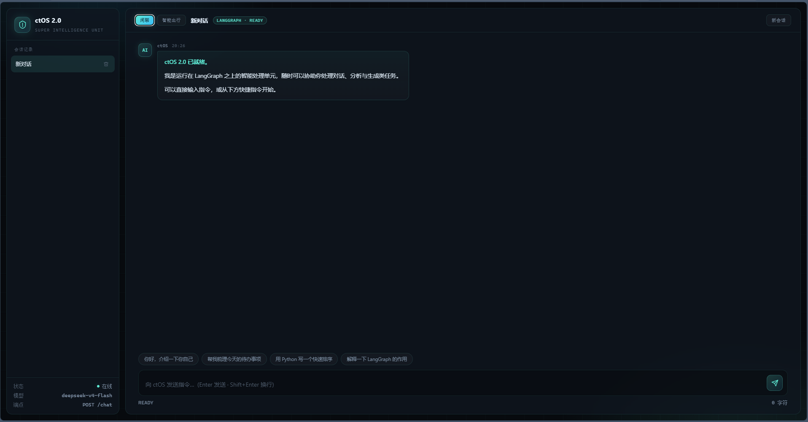
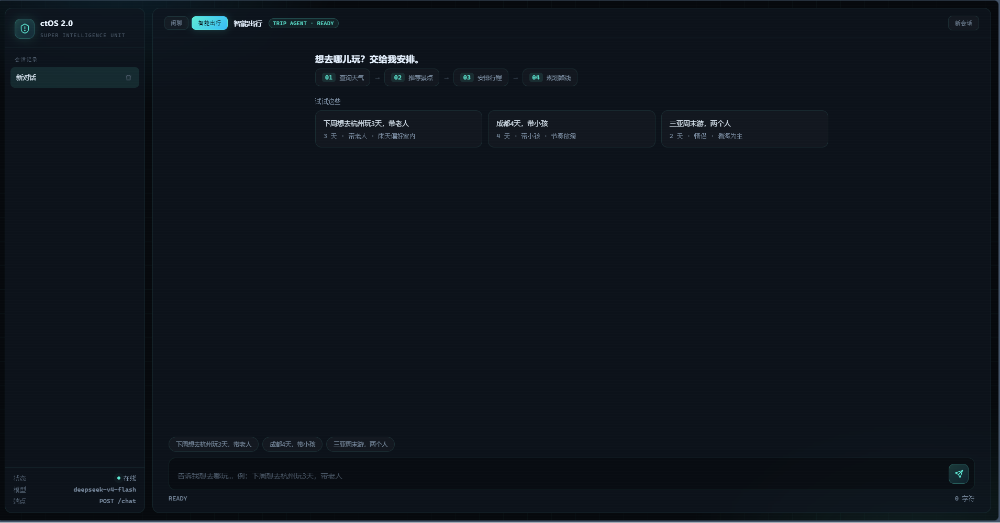

# ctOS 2.0

一个 FastAPI + LangGraph 搭建的多模块 AI 应用。同一个 FastAPI app 挂载多个能力模块，共用一套静态资源与会话接口。

> **本文是给智能客服模块检索用的知识库文档**，比项目根目录的 `README.md` 更详细。
> 根目录那份面向第一次接触项目的人，问答尽量短；本文则把「怎么用、有哪些模块、数据存在哪、
> 接口长什么样、出了问题怎么排查」都写全，方便客服回答问题。
> 两者的口径以代码为准，如有出入以本文和系统手册 `ctOS2_manual.md` 为准。

## 模块

三个模块都已接入 Web 页面：

| 模块 | 路由 | 说明 |
| --- | --- | --- |
| 闲聊 / 对话 | `/chat` | 基于 LangGraph 的对话图，流式返回纯文本 |
| 智能出行 | `/trip/chat` | 旅行规划 agent（天气 → 景点推荐 → 行程 → 路线），SSE 事件流 |
| 智能客服 | `/customer/chat` | RAG 三层检索问答（关键词 → 向量 → 混合），SSE 事件流 |

出行模块和客服模块都不是独立 app，它们是 ctOS 的能力。

三个模块各有一张 LangGraph 图，互不干扰：

- 闲聊：`START → chat_node → END`，最简单的一张图
- 出行：`START → weather → spots_agent →（工具循环）→ planner → route_agent → END`
- 客服：`START → retrieve → generate → END`，一条直线

三者的一个重要区别：**闲聊和出行会把我说的内容存进数据库**，左侧栏能翻到历史记录；
**智能客服是一问一答、不记会话、不带历史**，问完即走，不写数据库。

### 后端接口一览

| 方法 | 路径 | 所属模块 | 说明 |
| --- | --- | --- | --- |
| `POST` | `/chat` | 闲聊 | 请求 `{"messages": "...", "session_id": 可选}`，返回 `text/plain` 流，响应头带 `X-Session-Id` |
| `GET` | `/sessions` | 闲聊 | 会话列表，最近更新的排前面 |
| `GET` | `/sessions/{id}/messages` | 闲聊 | 某个会话的全部消息 |
| `DELETE` | `/sessions/{id}` | 闲聊 | 删除会话，消息级联删除 |
| `POST` | `/trip/chat` | 出行 | 请求 `{"query": "...", "history": [...]}`，返回 SSE |
| `GET` | `/trip/ping` | 出行 | 存活检测 |
| `GET` | `/trip/list` | 出行 | 最近的出行记录，默认最多 50 条 |
| `GET` | `/trip/{id}` | 出行 | 单条出行记录，含四段产出和用户原话 |
| `DELETE` | `/trip/{id}` | 出行 | 删除出行记录，两个子表级联删除 |
| `POST` | `/customer/chat` | 客服 | 请求 `{"query": "..."}`，返回 SSE |
| `GET` | `/customer/ping` | 客服 | 存活检测 |
| `GET` | `/` | —— | 前端页面 `static/index.html` |

SSE 事件名统一是：`START`、`STEP`、`TOKEN`、`DONE`、`CHAT`、`ERROR`。
客服模块只用到 `START` / `TOKEN` / `DONE` / `ERROR`；`STEP` 和 `CHAT` 是出行模块专有的。

## 界面预览

**闲聊模式**（`/chat`）——流式纯文本对话：



**智能出行**（`/trip/chat`）——查询天气 → 推荐景点 → 安排行程 → 规划路线：



## 目录结构

```
ctOS2.0/
├── src/                        # 后端主服务
│   ├── ctOS_chat_api.py        # ★ FastAPI 入口（app 在这里）
│   ├── ctOS_chat_graph.py      # 对话图
│   ├── ctOS_chat_graphOn.py    # 对话图对外入口 run_graph
│   ├── ctOS_chat_agent_node.py # 图节点
│   ├── ctOS_chat_llm.py        # LLM 初始化
│   ├── ctOS_chat_promtps.py    # 提示词
│   ├── ctOS_chat_sessions.py   # 会话读写
│   └── ctOS_chat_state.py      # 图状态定义
├── ctOS2_modules/
│   ├── ctOS2_Trip_AI/          # 智能出行模块
│   │   ├── ctOS2_Trip_main.py      # 终端调试入口
│   │   ├── ctOS2_Trip_stream.py    # 流式细节（读取 config/.env）
│   │   ├── ctOS2_Trip_create_graph.py  # 组装图
│   │   ├── ctOS2_Trip_agent_node.py    # 四个节点
│   │   ├── ctOS2_Trip_agent_tools.py   # 三个工具（天气/搜索/路线）
│   │   ├── ctOS2_Trip_route.py         # 条件边：景点 agent 要不要继续搜
│   │   ├── ctOS2_Trip_prompts.py       # 提示词
│   │   ├── ctOS2_Trip_llm.py           # LLM 初始化
│   │   └── ctOS2_Trip_state.py         # 图状态定义
│   └── ctOS2_customer_AI/      # 智能客服模块（RAG）
│       ├── main.py                 # 终端调试入口（会打印三层检索详情）
│       ├── ctOS2_customer_stream.py # 流式封装（对外唯一入口）
│       ├── create_graph.py         # 组装图
│       ├── agent_node.py           # 图节点（检索、生成）
│       ├── agent_state.py          # 图状态定义
│       ├── get_llm.py              # 读配置、模型客户端、路径常量
│       ├── promtps.py              # 提示词（文件名就是拼错的 prompts）
│       ├── rag_store.py            # 知识库加载与复用（只加载一次）
│       ├── rag_ingest.py           # 一次性入库脚本
│       ├── rag_keyword.py          # 第一层：关键词检索
│       ├── rag_vector.py           # 第二层：向量检索
│       ├── rag_hybrid.py           # 第三层：混合检索
│       └── data/
│           ├── docs/               # 知识库原始文档（本文就在这里）
│           └── chroma/             # 向量库落盘目录（由入库脚本生成）
├── ctOS2_databases/            # SQLite 数据库层
│   ├── ctOS2_db.py             # ★ 连接层 + 统一建表入口
│   ├── ctOS2_db_chat.py        # 闲聊表：sessions / messages
│   ├── ctOS2_db_trip.py        # 出行表：trip_sessions / trip_user_inputs / trip_ai_outputs
│   ├── ctOS2_db_view.py        # 命令行查看工具
│   └── ctOS2_db.db             # 数据库文件（自动生成，不入库）
├── static/                     # 前端（无构建步骤）
│   ├── index.html              # 页面结构
│   ├── README.md               # 前端文件说明
│   ├── css/style.css           # 全部样式
│   └── js/
│       ├── app.js              # 核心：状态、侧边栏、闲聊、模块切换
│       ├── trip.js             # 智能出行
│       ├── customer.js         # 智能客服
│       └── app.js.bak          # 旧版单文件备份（未被页面加载，可删）
├── screenshots/                # README 用的界面截图
└── config/
    ├── YOUR_config.env         # 配置模板（入库）
    ├── .env                    # 真实密钥（已 gitignore，不入库）
    └── requirements.txt
```

## 数据存储

所有业务数据存在同一个 SQLite 文件 `ctOS2_databases/ctOS2_db.db` 里，共 5 张表：

| 表 | 所属模块 | 说明 |
| --- | --- | --- |
| `sessions` | 闲聊 | 一次会话，主键 `id` |
| `messages` | 闲聊 | 会话里的消息，外键 `session_id` → `sessions.id` |
| `trip_sessions` | 出行 | 一轮出行规划，主键 `id` |
| `trip_user_inputs` | 出行 | 用户输入，外键 `trip_id` → `trip_sessions.id` |
| `trip_ai_outputs` | 出行 | AI 四段产出，外键 `trip_id` → `trip_sessions.id` |

两个外键都设了 `ON DELETE CASCADE`：删掉主记录，子记录自动跟着删。

智能客服是一问一答，**不写数据库**，所以没有自己的表。它的「知识」只落在本地 Chroma 目录里。

几个字段值得知道：

- `sessions.title`：会话标题，取用户第一句话的前 14 个字
- `sessions.updated_at`：每次追加消息都会刷新，会话列表按它倒序排
- `messages.role`：只能是 `user` 或 `assistant`
- `trip_sessions.turn_kind`：`TRAVEL` 表示真跑了出行图，`CHAT` 表示被判为闲聊、只回了一句话
- `trip_sessions.destination / days / start_date`：从需求里解析出来的出行要素
- `trip_ai_outputs`：`weather` / `spots` / `itinerary` / `route_plan` 四段产出，加 `chat_reply`

连接层 `ctOS2_db.open_database()` 每次开连接都会打开外键检查、开启 WAL 模式、设置按列名取值。
**不要另写第二份开连接的代码**，否则某个模块漏了开外键就会悄悄出 bug。

查看数据库内容（不用装任何工具）：

```bash
python ctOS2_databases/ctOS2_db_view.py            # 列出所有会话
python ctOS2_databases/ctOS2_db_view.py show 3     # 看某个会话的完整对话
python ctOS2_databases/ctOS2_db_view.py search 杭州 # 搜内容
python ctOS2_databases/ctOS2_db_view.py export 3   # 导出某个会话为 txt
python ctOS2_databases/ctOS2_db_view.py stats      # 统计
```

> `ctOS2_db_view.py` 只查闲聊的两张表（`sessions` / `messages`），看不到出行记录。

## 快速开始

### 1. 安装依赖

```bash
python -m venv venv
venv\Scripts\activate          # Windows
# source venv/bin/activate     # macOS / Linux

pip install -r config/requirements.txt
```

依赖分三组：Web（fastapi / uvicorn / python-dotenv）、
出行模块（langgraph / langchain 系列 / langchain-tavily / openai / httpx）、
客服模块（chromadb / jieba / rank-bm25）。
其中 `langgraph-checkpoint-sqlite` 虽然列了，但当前代码并没有真的用到它——真正的持久化是自己写的 sqlite3 代码。

### 2. 配置环境变量

复制模板并填入自己的值：

```bash
cp config/YOUR_config.env config/.env
```

`config/.env` 需要填写：

```
DEEPSEEK_API_KEY=      # DeepSeek 密钥，对话和图上推理都用它
DEEPSEEK_BASE_URL=     # DeepSeek 接口地址
DEEPSEEK_MODEL=        # 模型名

TAVILY_API_KEY=        # Tavily 搜索密钥，智能出行查景点用
AMAP_KEY=              # 高德地图密钥，智能出行算路线用

ZHIPU_API_KEY=         # 智谱密钥，智能客服 RAG 向量化用（必填）
```

`ZHIPU_API_KEY` 是**必需**的：加载知识库时会先检查它，取不到就直接抛错。
也就是说没配这个密钥，智能客服模块启动不起来（其它模块不受影响）。

> `config/.env` 已被 `.gitignore` 忽略，**不要**提交真实密钥。

### 3. 初始化数据库

```bash
python ctOS2_databases/ctOS2_db.py
```

会建好闲聊和出行两边的全部 5 张表（已存在则跳过，不会动已有数据）。

### 4. 智能客服入库（第一次使用前跑一次）

智能客服依赖本地向量库，需要先把 `data/docs/` 里的文档切块、向量化、入库：

```bash
python ctOS2_modules/ctOS2_customer_AI/rag_ingest.py
```

注意几点：

- 入库用的是智谱接口，`ZHIPU_API_KEY` 必须先配好
- 只处理 `data/docs/` 下的 `*.md` 文件（不含子目录）
- 按 Markdown 的 `## ` 二级标题切块，单块超过 600 字符再按整行切开
- 向量化会自动分批：智谱接口限制一次最多 64 条，脚本按 `MAX_EMBED_BATCH = 64` 分批提交，
  所以文档块数超过 64 也能一次跑完
- 重复入库是安全的：每次会先删掉同名集合再重建
- **改了文档后要重新跑一次，并重启服务**，否则检索到的还是旧内容

### 5. 启动服务

```bash
python src/ctOS_chat_api.py
```

打开 <http://127.0.0.1:8080/> 即为前端页面。

> 端口 8080 写死在 `src/ctOS_chat_api.py` 末尾的 `uvicorn.run(app, host="127.0.0.1", port=8080)`，
> 前端用相对路径请求后端（同源），所以换端口只改这一处即可。
>
> 也可以用 uvicorn 命令启动，但**端口必须和 8080 保持一致**：
>
> ```bash
> uvicorn src.ctOS_chat_api:app --reload --port 8080
> ```

## 前端开发

前端**没有任何构建步骤**：改代码保存后刷新浏览器即可生效。

| 文件 | 负责 |
| --- | --- |
| `static/js/app.js` | 核心状态、侧边栏、闲聊、模块切换 |
| `static/js/trip.js` | 智能出行（四段卡片、出行历史） |
| `static/js/customer.js` | 智能客服（问答渲染） |
| `static/css/style.css` | 全部样式 |

三个 JS 文件按 `app.js → trip.js → customer.js` 的顺序加载，后两个依赖 `app.js` 里的 `$`、`esc`、`md`、`API`、`state` 等全局变量，**调整加载顺序会导致报错**。

`static/js/app.js.bak` 是旧版单文件备份，`index.html` 并未引用它，保留与否不影响运行。

详见 [`static_README.md`](static_README.md)。

## 单独调试各模块

出行模块可以脱离 Web 服务在终端直接跑：

```bash
python ctOS2_modules/ctOS2_Trip_AI/ctOS2_Trip_main.py
```

客服模块同样可以，每轮会打印三层检索各命中了什么，方便调检索效果：

```bash
python -X utf8 ctOS2_modules/ctOS2_customer_AI/main.py
```

> Windows 控制台默认 GBK，不加 `-X utf8` 中文可能乱码。

单独检查知识库是否就绪（不启动对话）：

```bash
python -X utf8 ctOS2_modules/ctOS2_customer_AI/rag_store.py
```

单独跑一遍客服的流式封装（用一条固定问题验证 SSE 事件能正常吐出）：

```bash
python -X utf8 ctOS2_modules/ctOS2_customer_AI/ctOS2_customer_stream.py
```

## 智能客服是怎么工作的

这一段是客服模块自己的说明，方便被问到「智能客服怎么工作」时能直接答。

- **三层检索**：关键词（jieba 分词 + BM25）→ 向量（智谱 embedding-3 + Chroma）→ 混合（按名次加权，取前 4 条）
- **只答知识库里的内容**：检索不到就回「抱歉，我在知识库里没有找到相关答案。」
- **不编造**：提示词里写死「回答只能来自参考资料」，不许用模型自己的知识补充
- **不闲聊**：每句都走检索，聊天功能由闲聊模块承担
- **不记会话**：一问一答，不带历史，不写数据库

检索不到资料时代码**不会跳过模型调用**，而是照样调用，只在参考资料位置放一句「（没有检索到任何资料）」，
让「答不出来」这句话也由模型统一输出，代码里不需要写分支。

## 技术栈

- **Web**：FastAPI、Uvicorn、Pydantic
- **编排**：LangGraph、LangChain、langchain-openai
- **工具**：Tavily 搜索、高德地图、Open-Meteo 天气
- **存储**：SQLite（Python 标准库 `sqlite3`）存会话与出行记录；Chroma 存 RAG 向量
- **检索**：智谱 embedding-3、jieba + rank-bm25
- **配置**：python-dotenv

## 常见问题

**为什么客服不跟我闲聊？**
这是刻意设计。客服的职责是「查资料回答问题」，不是聊天。聊天由闲聊模块承担。

**为什么客服总说没找到答案？**
先确认要问的内容是否已经写进 `data/docs/` 下的文档；改完文档要重新跑入库脚本并重启服务。
如果文档里有但还答不出，可能是问法差异太大，可以换个说法。

**对话记录会丢吗？**
不会。闲聊和出行都存在本地 SQLite 文件里，重启服务和刷新页面都还在。只有智能客服不留记录。

**端口可以改吗？**
可以，只改 `src/ctOS_chat_api.py` 末尾 `uvicorn.run(...)` 里的端口这一处即可，前端不用动。

## 安全说明

- 所有密钥均从 `config/.env` 读取，代码中不写死任何凭据。
- 数据库为本地 SQLite 文件，不含账号密码；但这种文件本身没有访问权限控制，谁拿到谁能读，不要外传。
- `.gitignore` 已排除 `config/.env`、`*.env`、`venv/`、`__pycache__/`、`*.sql`、`*.sqlite`、`*.db` 等。
- 若曾误提交密钥，请立即在对应平台轮换（删除文件并不能让密钥失效）。
