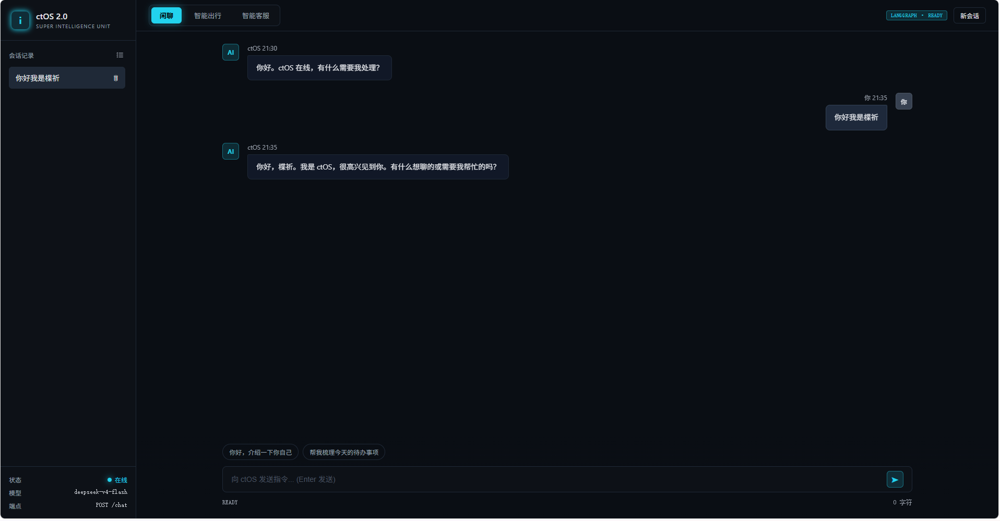
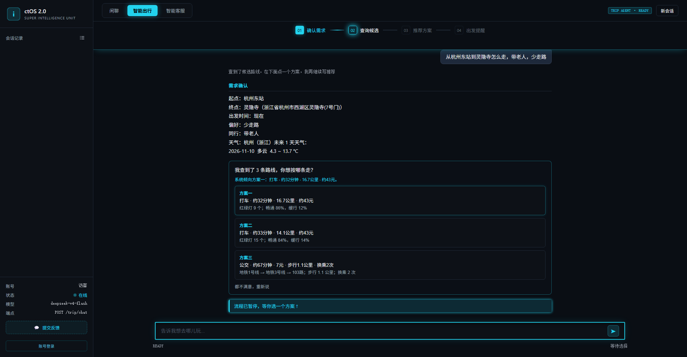

# ctOS 2.0

一个 FastAPI + LangGraph 搭建的多模块 AI 应用。同一个 FastAPI app 挂载多个能力模块，共用一套静态资源与会话接口。

> **线上地址：<https://ctos2.cn>**（也可用 `www.ctos2.cn`），打开页面会先进入访客空间，注册账号后可跨设备保留记录。
> 没有绑定任何本地端口，线上走 Cloudflare 提供的 HTTPS。

> **本文是给智能客服模块检索用的知识库文档**，比项目根目录的 `README.md` 更详细。
> 根目录那份面向第一次接触项目的人，问答尽量短；本文则把「怎么用、有哪些模块、数据存在哪、
> 接口长什么样、出了问题怎么排查」都写全，方便客服回答问题。
> 两者的口径以代码为准，如有出入以本文和系统手册 `ctOS2_manual.md` 为准。

## 模块

**四个能力模块都已接入 Web 页面**，页面顶栏有三个标签（闲聊 / 智能出行 / 智能客服），
角色扮演挂在「闲聊」里，从侧栏的「角色扮演」菜单进入：

| 模块 | 路由 | 说明 |
| --- | --- | --- |
| 闲聊 / 对话 | `/chat` | 基于 LangGraph 的对话图，流式返回纯文本 |
| 角色扮演 | `/chat`（带 `role_id`）+ `/roleplay/*` | 预设角色、自己写角色、AI 帮我查；会话复用闲聊的表 |
| 智能出行 | `/trip/chat` | 双模式：路线决策（查真实多方案、人工选一条）+ 旅游攻略（天气 → 景点 → 人工勾选 → 行程 → 路线），SSE 事件流 |
| 智能客服 | `/customer/chat` | RAG 三层检索问答（关键词 → 向量 → 混合），SSE 事件流 |

出行模块和客服模块都不是独立 app，它们是 ctOS 的能力。

每个业务模块各有一张 LangGraph 图，互不干扰：

- 闲聊：`START → chat_node → END`，最简单的一张图
- 角色扮演：不走图，直接拼提示词调模型流式输出（`modules/roleplay/stream.py`）
- 出行·路线决策：`START → collect_routes → ask_user（暂停等选方案）→ compare_routes → decide_route → write_tips → END`
- 出行·旅游攻略：`START → weather → spots_agent →（工具循环）→ ask_spots（暂停等勾选）→ planner → route_agent → END`
- 客服：`START → retrieve → generate → END`，一条直线

三者的一个重要区别：**闲聊、角色扮演和出行会把我说的内容存进数据库**，左侧栏能翻到历史记录；
**智能客服问答本身不写数据库**（但会把最近 3 轮对话带上，用来理解追问），刷新页面就没了。

### 后端接口一览

除 `/auth/*`、`/health`、`/trip/ping`、`/customer/ping`、`/notice`、`/feedback` 和静态资源外，
**所有接口都要先登录**，请求头带 `Authorization: Bearer <token>`。

| 方法 | 路径 | 所属模块 | 说明 |
| --- | --- | --- | --- |
| `POST` | `/auth/register` | 认证 | 注册邮箱 + 密码，自动创建一个专属租户，直接返回 token |
| `POST` | `/auth/login` | 认证 | 登录，返回 token |
| `GET` | `/auth/me` | 认证 | 查当前登录用户，前端刷新页面时用来验证 token |
| `POST` | `/auth/trial` | 认证 | 免注册建一个访客账号并直接登录（页面首次打开自动调用） |
| `POST` | `/chat` | 闲聊 | 请求 `{"messages": "...", "session_id": 可选, "role_id": 可选}`，返回 `text/plain` 流，响应头带 `X-Session-Id` |
| `GET` | `/sessions` | 闲聊 | 会话列表，每条带 `role_id`（角色会话才有值） |
| `GET` | `/sessions/{id}/messages` | 闲聊 | 某个会话的全部消息 |
| `DELETE` | `/sessions/{id}` | 闲聊 | 删除会话，消息级联删除 |
| `GET` | `/roleplay/roles` | 角色扮演 | 预设角色 + 自己写的角色 |
| `GET` | `/roleplay/roles/{id}` | 角色扮演 | 一个角色的完整档案 |
| `POST` | `/roleplay/roles` | 角色扮演 | 保存自己写的 / AI 查出来的角色 |
| `POST` | `/roleplay/roles/search` | 角色扮演 | AI 帮我查，生成角色草稿（不存库） |
| `DELETE` | `/roleplay/roles/{id}` | 角色扮演 | 删除自定义角色（预设角色不能删） |
| `POST` | `/roleplay/start` | 角色扮演 | 选一个角色开始：建会话、绑角色、存开场白 |
| `GET` | `/roleplay/session/{id}` | 角色扮演 | 这个会话是哪个角色（普通聊天返回 `role: null`） |
| `GET` | `/roleplay/memory/{role_id}` | 角色扮演 | 这个角色记住了什么 |
| `POST` | `/roleplay/memory/clear` | 角色扮演 | 清空这个角色的记忆 |
| `POST` | `/trip/chat` | 出行 | 请求 `{"query": "...", "history": [...], "chat_id": 可选}`，返回 SSE |
| `POST` | `/trip/route/choose` | 出行 | 路线决策暂停后，用户选了哪个方案，继续写结论 |
| `POST` | `/trip/guide/spots` | 出行 | 旅游攻略暂停后，用户勾掉/补充了哪些景点，继续排行程 |
| `POST` | `/trip/guide/route` | 出行 | 旅游攻略跑完后，用户要不要查真实路线 |
| `GET` | `/trip/ping` | 出行 | 存活检测 |
| `GET` | `/trip/list` | 出行 | 最近的出行记录，默认最多 50 条 |
| `GET` | `/trip/{id}` | 出行 | 单条出行记录，含各段产出和用户原话 |
| `DELETE` | `/trip/{id}` | 出行 | 删除出行记录，子表级联删除 |
| `POST` | `/trip/delete-batch` | 出行 | 批量删除，请求 `{"ids": [...]}` |
| `POST` | `/customer/chat` | 客服 | 请求 `{"query": "...", "history": [...]}`，返回 SSE |
| `GET` | `/customer/ping` | 客服 | 存活检测 |
| `POST` | `/feedback` | 反馈 | 提交评价 + 文字反馈，同一 IP 每分钟最多 3 条，不强制登录 |
| `GET` | `/notice` | —— | 更新公告，内容来自 `config/notice.json` |
| `GET` | `/health` | —— | 健康检查，返回数据库名和连接用户 |
| `GET` | `/` | —— | 前端页面 `static/index.html` |

SSE 事件名统一是：`SAY`、`START`、`STEP`、`TOKEN`、`DONE`、`CHAT`、`ERROR`，出行结束时还会发一条 `SAVED`（带 `chat_id`）。
出行模块还会发几个“等你操作”的事件：`ASK_PLACE`（地名有歧义，先挑一个）、`ASK`（选路线方案）、
`ASK_SPOTS`（勾选景点）、`ASK_ROUTE`（问要不要查真实路线）。
客服模块只用到 `START` / `TOKEN` / `DONE` / `ERROR`。

## 界面预览

**闲聊模式**（`/chat`）——流式纯文本对话：



**智能出行**（`/trip/chat`）——两种模式，中途都会暂停让你确认：



线上可以直接看：<https://ctos2.cn>（点顶栏切换模块，角色扮演在左侧菜单里）。

## 目录结构

```
ctOS2.0/
├── api/                        # HTTP 接口层
│   ├── main.py                 # ★ FastAPI 入口，所有业务路由都在这里
│   └── routes/
│       ├── auth.py             # 认证路由：/auth/register、/auth/login、/auth/me
│       └── trial.py            # 访客账号：/auth/trial（独立文件，可整块删）
├── core/                       # 跨模块公用
│   ├── llm.py                  # 唯一的模型客户端 get_llm()，也负责加载 .env
│   ├── db.py                   # PostgreSQL 连接 + 建表总入口 create_all_tables()
│   ├── auth.py                 # 密码 bcrypt 哈希 + JWT 签发与校验
│   └── sse.py                  # SSE 事件打包 + 把同步生成器放进工作线程
├── databases/                  # 表和读写（一个业务模块一个文件）
│   ├── db_tenant.py            # 全局身份表 tenants
│   ├── db_auth.py              # 用户表 users
│   ├── db_chat.py              # 闲聊表 sessions / messages
│   ├── db_trip.py              # 出行表 trip_chats / trip_sessions / trip_user_inputs / trip_ai_outputs
│   ├── db_roleplay.py          # 角色扮演表 role_play_sessions / role_play_memories / role_play_roles
│   ├── db_feedback.py          # 反馈表 feedback
│   ├── db_view.py              # 命令行查看工具
│   ├── clean_db.py             # 命令行清理工具
│   └── feedback_view.py        # 命令行查看反馈
├── modules/                    # 四个业务模块
│   ├── chat/                   # 闲聊：graph / node / prompts / state / stream / sessions
│   ├── roleplay/               # 角色扮演：roles / presets / prompts / stream / search / memory / openings
│   ├── trip/                   # 智能出行
│   │   ├── graph.py            # 攻略图（天气 → 景点 → 等勾选 → 行程 → 路线）
│   │   ├── node.py             # 攻略的四个节点
│   │   ├── route.py            # 条件边：景点 agent 要不要继续搜
│   │   ├── tools.py            # 三个工具：天气 / 联网搜索 / 路线
│   │   ├── prompts.py          # 攻略提示词 + 意图分流提示词
│   │   ├── state.py            # 图状态定义
│   │   ├── understand.py       # 第一句分流：路线 / 攻略 / 闲聊
│   │   ├── stream.py           # 对外唯一入口 trip_stream()，产出 SSE
│   │   ├── guide_ask.py        # 攻略暂停节点：收用户勾选的景点
│   │   ├── guide_stream.py     # 攻略出口：暂停、恢复、问要不要查真实路线
│   │   ├── route_decision_tools.py   # 高德路线数据：地点 / 驾车 / 公交 / 步行 / 骑行
│   │   ├── route_decision_prompts.py # 路线决策的 4 个提示词
│   │   ├── route_decision_graph.py   # 路线决策图：查候选 → 暂停 → 写结论
│   │   ├── route_decision_stream.py  # 路线决策出口：解析 / 校验 / 暂停恢复 / 存库
│   │   └── cli.py              # 终端调试入口
│   └── customer/               # 智能客服（RAG）
│       ├── graph.py            # START → retrieve → generate → END
│       ├── node.py             # 检索节点、生成节点
│       ├── state.py            # 图状态定义
│       ├── prompts.py          # 回答提示词
│       ├── stream.py           # 对外唯一入口 customer_stream()
│       ├── rag_store.py        # 知识库加载（全进程只加载一次）
│       ├── rag_ingest.py       # 一次性入库脚本
│       ├── rag_search.py       # 三层检索：关键词 / 向量 / 混合
│       ├── rag_config.py       # 文档目录、向量库目录、集合名、embedding 模型
│       ├── rag_eval.py         # 检索测评脚本（40 题）
│       ├── eval/golden.json    # 测评题库
│       └── data/
│           ├── docs/           # 知识库原始文档（本文就在这里）
│           └── chroma/         # 向量库落盘目录（由入库脚本生成，不入库）
├── static/                     # 前端（无构建步骤）
│   ├── index.html              # 页面结构
│   ├── README.md               # 前端文件说明
│   ├── css/style.css           # 模板原样式
│   ├── css/modules.css         # 出行卡片、客服气泡、登录页等新增样式
│   ├── css/theme.css           # 三套主题：简洁现代 / 街头黑客 / 赛博暗色
│   └── js/
│       ├── common/             # 公用：配置、工具、认证、SSE 解析、打字机、多选、中断……
│       ├── app.js              # 核心：状态、侧边栏、闲聊、角色扮演、模块切换
│       ├── trip.js             # 智能出行（双模式、方案选择、景点勾选）
│       └── customer.js         # 智能客服
├── screenshot/                 # README 用的界面截图
├── docs/                       # 项目文档
├── eval/                       # 端到端测评（34 条）
├── config/                     # .env、配置模板、requirements.txt
├── Dockerfile                  # 镜像构建
└── docker-compose.yml          # 应用 + 数据库两个容器
```

## 数据存储

所有业务数据存在 PostgreSQL 数据库 `ctos2` 里，共 12 张表：

| 表 | 所属模块 | 说明 |
| --- | --- | --- |
| `tenants` | 全局 | 租户，一个注册用户对应一个租户；所有业务表都外键引用它 |
| `users` | 认证 | 账号，邮箱唯一，密码存 bcrypt 哈希 |
| `sessions` | 闲聊 | 一次会话，主键 `id`（角色扮演复用这张表） |
| `messages` | 闲聊 | 会话里的消息，外键 `session_id` → `sessions.id` |
| `trip_chats` | 出行 | 一次出行对话（左侧列表的一条） |
| `trip_sessions` | 出行 | 一轮出行规划，主键 `id` |
| `trip_user_inputs` | 出行 | 用户输入，外键 `trip_id` → `trip_sessions.id` |
| `trip_ai_outputs` | 出行 | AI 各段产出，外键 `trip_id` → `trip_sessions.id` |
| `role_play_sessions` | 角色扮演 | 哪个聊天会话用的是哪个角色（外键 `session_id` → `sessions.id`） |
| `role_play_memories` | 角色扮演 | 每个角色记住的事，按「租户 + 角色」存一篇 200 字以内摘要 |
| `role_play_roles` | 角色扮演 | 用户自己写的角色，id 形如 `custom_12` |
| `feedback` | 反馈 | 用户提交的评价和意见 |

外键都设了 `ON DELETE CASCADE`：删掉主记录，子记录自动跟着删。

**所有业务表都有 `tenant_id`**，每个请求由 API 层从登录 token 里解析出当前租户传下去，
查询时一律带上它，所以不同账号之间看不到对方的数据。

智能客服是一问一答，**不写数据库**，所以没有自己的表。它的「知识」只落在本地 Chroma 目录里。

除了这 12 张表，还有两处**运行产物、不入 git**：

- `databases/checkpoints/route_checkpoints.sqlite`：出行的 LangGraph 暂停现场（SQLite）
- `modules/customer/data/chroma/`：客服的向量库

几个字段值得知道：

- `sessions.title`：会话标题，取用户第一句话的前 14 个字
- `sessions.updated_at`：每次追加消息都会刷新，会话列表按它倒序排
- `messages.role`：只能是 `user` 或 `assistant`
- `trip_sessions.turn_kind`：`ROUTE` 表示路线决策，`TRAVEL` 表示旅游攻略，`CHAT` 表示被判为闲聊、只回了一句话
- `trip_sessions.destination / days / start_date`：从需求里解析出来的出行要素
- `trip_ai_outputs`：攻略四段 `weather` / `spots` / `itinerary` / `route_plan`；
  路线决策四段 `route_need` / `route_compare` / `route_decision` / `route_tips`；再加 `chat_reply`
- `role_play_memories.rounds`：这个角色聊了几轮，每满 6 轮整理一次记忆
- `feedback.rating`：存中文原文（很满意 / 满意 / 一般 / 不太满意），不存数字

连接层 `core/db.py` 的 `get_conn()` 每个操作开一个短连接，用完自动关，
出错自动回滚；`transaction()` 把多条写入包成一个事务。
**不要另写第二份开连接的代码**，所有 SQL 都走 `core/db.py` 提供的 `query` / `query_one` / `execute`。

查看数据库内容（不用装任何工具）：

```bash
python -X utf8 -m databases.db_view            # 列出所有会话
python -X utf8 -m databases.db_view show 3     # 看某个会话的完整对话
python -X utf8 -m databases.db_view trips      # 出行列表
python -X utf8 -m databases.db_view stats      # 统计
python -X utf8 -m databases.feedback_view      # 用户反馈
```

> `db_view.py` 用命令行查看闲聊的几张表。线上的数据在 `ctos2-db` 容器里：
> `docker exec ctos2-db psql -U ctos_app ctos2` 可以直接进去查。

## 快速开始

### 1. 安装依赖

```bash
python -m venv venv
venv\Scripts\activate          # Windows
# source venv/bin/activate     # macOS / Linux

pip install -r config/requirements.txt
```

依赖分几组：Web（fastapi / uvicorn / python-dotenv）、
Agent 编排（langgraph / langchain 系列 / openai / httpx）、
客服模块（chromadb / jieba / rank-bm25）、
数据库（psycopg）、认证（python-jose / bcrypt）。
其中 `langgraph-checkpoint-sqlite` 是出行暂停现场用的——`modules/trip/route_decision_graph.py`
用它把 interrupt 的状态落到 `databases/checkpoints/`；业务数据本身仍然走 PostgreSQL。

### 2. 配置环境变量

复制模板并填入自己的值：

```bash
cp config/YOUR_config.env config/.env
```

`config/.env` 需要填写：

```
DEEPSEEK_API_KEY=      # DeepSeek 密钥，对话、图上推理、联网搜索都用它
DEEPSEEK_BASE_URL=     # DeepSeek 接口地址
DEEPSEEK_MODEL=        # 模型名

AMAP_KEY=              # 高德地图密钥，智能出行算路线用

ZHIPU_API_KEY=         # 智谱密钥，智能客服 RAG 向量化用（必填）

# 数据库（PostgreSQL）
PG_HOST= / PG_PORT= / PG_DBNAME= / PG_USER= / PG_PASSWORD=

# 认证：登录 token 的签名密钥，用 python -c "import secrets; print(secrets.token_urlsafe(48))" 生成
JWT_SECRET_KEY=
```

`ZHIPU_API_KEY` 对客服模块是**必需**的：加载知识库时会先检查它，取不到就直接抛错。
也就是说没配这个密钥，智能客服模块用不了（其它模块不受影响）。

**项目本身不含任何密钥**，clone 下来必须自己申请并填写，否则跑不起来。
几个密钥的用途、必要性、申请地址：

| 密钥 | 用途 | 必要性 | 去哪申请 |
| --- | --- | --- | --- |
| `DEEPSEEK_API_KEY` / `DEEPSEEK_BASE_URL` / `DEEPSEEK_MODEL` | 所有对话和推理，出行搜景点也复用这个密钥 | 必需，缺了闲聊、角色扮演和出行都不能用 | platform.deepseek.com |
| `ZHIPU_API_KEY` | 智能客服向量化 | 必需，缺了客服模块用不了 | open.bigmodel.cn |
| `AMAP_KEY` | 出行模块算路线 | 出行要用，缺了只能走攻略流程 | lbs.amap.com |
| `JWT_SECRET_KEY` | 登录 token 签名 | 必需，缺了启动就报错 | 自己生成 |

这些外部 API 大多需要注册账号，部分需要付费或有免费额度限制，具体以各家官网为准。

只想先试一个模块的话，最少需要配：

- 只看闲聊 / 角色扮演：`DEEPSEEK_API_KEY`、`DEEPSEEK_BASE_URL`、`DEEPSEEK_MODEL`、`JWT_SECRET_KEY`
- 加智能出行：再补 `AMAP_KEY`（联网搜索复用 DeepSeek 密钥，不用另外申请）
- 加智能客服：再补 `ZHIPU_API_KEY`

> `config/.env` 已被 `.gitignore` 忽略，**不要**提交真实密钥。

### 3. 初始化数据库

```bash
python -X utf8 -m core.db
```

会建好全部 12 张表（`tenants` / `users` / `sessions` / `messages` / `trip_chats` /
`trip_sessions` / `trip_user_inputs` / `trip_ai_outputs` / `role_play_sessions` /
`role_play_memories` / `role_play_roles` / `feedback`），已存在则跳过，不会动已有数据。
**没建表的话注册登录会直接报错。**
升级代码之后也建议再跑一次，它会补上新增的表和字段（`ADD COLUMN IF NOT EXISTS`）。

### 4. 智能客服入库（第一次使用前跑一次）

智能客服依赖本地向量库，需要先把 `data/docs/` 里的文档切块、向量化、入库：

```bash
python -X utf8 -m modules.customer.rag_ingest
```

注意几点：

- 入库用的是智谱接口，`ZHIPU_API_KEY` 必须先配好
- 只处理 `data/docs/` 下的 `*.md` 文件（不含子目录）
- 按 Markdown 的 `## ` 二级标题切块，单块超过 600 字符再按整行切开
- 向量化会自动分批：智谱接口限制一次最多 64 条，脚本按 `MAX_EMBED_BATCH = 64` 分批提交，
  所以文档块数超过 64 也能一次跑完
- 重复入库是安全的：每次会先删掉同名集合再重建
- **改了文档后要重新跑一次，并重启服务**，否则检索到的还是旧内容

### 5. 启动服务

```bash
python -X utf8 -m api.main
```

打开 <http://127.0.0.1:8080/> 即为前端页面。线上对应的是 <https://ctos2.cn/>。

> 本地默认监听 `127.0.0.1:8080`，由 `api/main.py` 末尾 `uvicorn.run(app, host=..., port=...)` 决定，
> `HOST` / `PORT` 两个环境变量可以覆盖。
> 前端用相对路径请求后端（同源），所以换端口只改这一处即可。
>
> 容器（含线上）里必须监听 `0.0.0.0`，Dockerfile 已经设好 `HOST=0.0.0.0`。

## 前端开发

前端**没有任何构建步骤**：改代码保存后刷新浏览器即可生效。

| 文件 | 负责 |
| --- | --- |
| `static/js/common/` | 公用：配置、工具函数、认证、更新公告、反馈、SSE 解析、打字机、多选、请求中断 |
| `static/js/app.js` | 核心状态、侧边栏、闲聊、角色扮演、模块切换 |
| `static/js/trip.js` | 智能出行（四段卡片、出行历史、人工确认面板） |
| `static/js/customer.js` | 智能客服（问答渲染） |
| `static/css/style.css` | 模板原样式 |
| `static/css/modules.css` | 出行卡片、客服气泡、登录页等新增样式 |
| `static/css/theme.css` | 三套主题的颜色和组件覆盖 |

`common/` 里的文件最先加载，然后 `app.js`，最后 `trip.js` / `customer.js`。
后加载的依赖先加载的全局变量，**调整加载顺序会导致报错**。详见 `static/README.md`。

## 单独调试各模块

出行模块可以脱离 Web 服务在终端直接跑：

```bash
python -X utf8 -m modules.trip.cli
```

> Windows 控制台默认 GBK，不加 `-X utf8` 中文可能乱码。

单独检查知识库是否就绪（不启动对话）：

```bash
python -X utf8 -m modules.customer.rag_store
```

单独跑一遍客服的流式封装（用一条固定问题验证 SSE 事件能正常吐出）：

```bash
python -X utf8 -m modules.customer.stream
```

检测检索质量（40 题题库，分原词 / 同义改写 / 跨章节 / 库外四类）：

```bash
python -X utf8 -m modules.customer.rag_eval
```

端到端测评四个模块（34 条题库，需要服务已启动）：

```bash
python -X utf8 eval/run_eval.py
```

## 智能客服是怎么工作的

这一段是客服模块自己的说明，方便被问到「智能客服怎么工作」时能直接答。

- **三层检索**：关键词（jieba 分词 + BM25）→ 向量（智谱 embedding-3 + Chroma）→ 混合（按名次加权，取前 4 条）
- **只答知识库里的内容**：检索不到就回「抱歉，我在知识库里没有找到相关答案。」
- **不编造**：提示词里写死「回答只能来自参考资料」，不许用模型自己的知识补充
- **不闲聊**：每句都走检索，聊天功能由闲聊模块承担
- **不写库**：问答不落数据库，刷新页面就没了
- **能接追问**：前端把最近几轮对话一起带过来，检索时用「上一轮问题 + 当前问题」拼成检索串，
  解决「那它怎么配」这类没有主语的追问搜不到东西的问题

检索不到资料时代码**不会跳过模型调用**，而是照样调用，只在参考资料位置放一句「（没有检索到任何资料）」，
让「答不出来」这句话也由模型统一输出，代码里不需要写分支。

## 技术栈

- **Web**：FastAPI、Uvicorn、Pydantic
- **编排**：LangGraph、LangChain、langchain-openai
- **模型**：DeepSeek（对话与推理）、智谱 embedding-3（向量化）
- **工具**：DeepSeek Search 联网搜索、高德地图、Open-Meteo 天气
- **存储**：PostgreSQL 17（会话与出行记录，多租户）；Chroma 存 RAG 向量
- **检索**：jieba + rank-bm25 与向量混合
- **认证**：JWT + bcrypt
- **部署**：Docker + Docker Compose，线上 <https://ctos2.cn> 由 Cloudflare 提供域名和 HTTPS
- **配置**：python-dotenv

## 常见问题

**为什么客服不跟我闲聊？**
这是刻意设计。客服的职责是「查资料回答问题」，不是聊天。聊天由闲聊模块承担。

**为什么客服总说没找到答案？**
先确认要问的内容是否已经写进 `data/docs/` 下的文档；改完文档要重新跑入库脚本并重启服务。
如果文档里有但还答不出，可能是问法差异太大，可以换个说法。

**对话记录会丢吗？**
不会。闲聊、角色扮演和出行都存在 PostgreSQL 数据库 `ctos2` 里，重启服务和刷新页面都还在。
只有智能客服不留记录。

**要注册才能用吗？**
不用。打开 <https://ctos2.cn> 会先自动进入一个**访客空间**（独立租户，记录只存在当前浏览器），
想跨设备保留记录再点侧栏底部「账号登录」注册或登录。每个账号的数据是隔离的，互相看不到。
访客账号的邮箱统一是 `trial_xxx@ctos-trial.local`，可用 `clean_db.py` 清理。

**线上地址是什么？**
<https://ctos2.cn>，`www.ctos2.cn` 也能访问，两个地址的页面完全一样。

**端口可以改吗？**
可以，用环境变量 `PORT`（容器和线上）或改 `api/main.py` 末尾 `uvicorn.run(...)` 里的端口（本地），前端不用动。

## 安全说明

- 所有密钥均从 `config/.env` 读取，代码中不写死任何凭据。
- 数据库是 PostgreSQL，密码同样在 `config/.env` 里；Docker 部署时数据库只在内网 `ctos2-net` 里，不直接暴露到公网。
- 接口都要登录：所有业务路由都从 `Authorization: Bearer <token>` 解析租户，未登录返回 401。
  例外是 `/auth/*`、`/health`、两个 `ping`、`/notice`、`/feedback` 和静态资源。
- `.gitignore` 已排除 `config/.env`、`*.env`、`venv/`、`__pycache__/`、`*.sql`、`*.db`、向量库目录、测评结果等。
- 若曾误提交密钥，请立即在对应平台轮换（删除文件并不能让密钥失效）。
